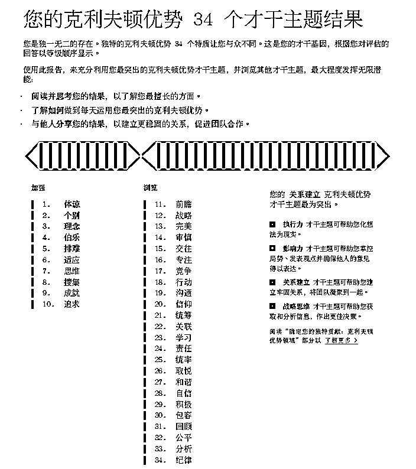
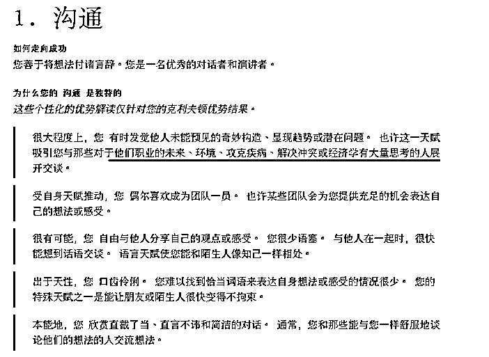
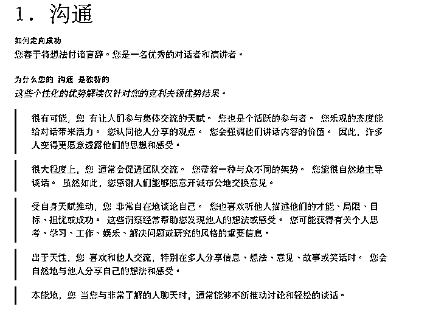

# 3.2 第二步：定位你的天赋排序

看清自己的优势维度之后，你对自身长处应该已经有了初步印象。接下来要做的，是进一步确认才干排名——这一步非常关键。

盖洛普将人的思维、情绪与行为方式归纳为34项才干。它们像每个人自带的原初能力，经过知识补充和技能打磨，便会逐步转化为可见的优势。

现在，请打开盖洛普报告第1页，找到自己的才干顺序。第2—11页会逐项分析你的前10项才干，其中前5项附有个性化解读，值得重点阅读。

由于每个人的排序不同，最终呈现出的价值观、性格和优势也会不一样。

通常，我们应把注意力放在排名靠前的才干上，因为那里更可能是能够发挥所长的天赋区；而越靠后的才干，往往代表平时较少调用的天赋，也可以理解为相对不擅长的部分。

拿醒醒来说，她常用的前三项才干是“体谅”“个别”“理念”，较少使用的是倒数三项“公平”“分析”“纪律”。（关于每项才干的具体含义，将在「3.4 了解 34 项基础才干」中展开说明。）

她往往能迅速捕捉他人的情绪需要（体谅），看到每个人身上的独特性（个别），也常冒出新鲜有趣的想法（理念）；但面对规则（公平）、数据与逻辑（分析）、计划安排（纪律）这类事务，她既不拿手，也很少留心。

由此看，醒醒可能具备的优势包括“共情力”“组建优势团队+人才发展”“创新力”；相对薄弱的地方则是制定规则、逻辑推理和做计划。

盖洛普为每一项才干都赋予了价值。越靠前的才干，越容易在无意识中轻松调用，也越可能是天赋所在。比如：

有人从小语文表现出色，物理数学却吃力，对文字的感受天然强于数字和逻辑，或许在文字方面有天赋；有人从小就爱和朋友一起玩，不愿总待在家里，可能在社交方面有天赋；有人自幼喜欢观察人、琢磨人，或许具备识人辨人的天赋。

这些从小就显露的特质，在盖洛普测评中大概率会排在较前位置。大致可以这样划分：

• 排名1—10的才干：属于突出才干，越靠前越可能是最擅长的天赋，天然容易在某些方面做得不错。
• 排名11—20的才干：属于辅助才干，偶尔会派上用场，也能帮你把事情做好，但使用频率未必高于前10项。
• 排名21—34的才干：属于底部才干，越往后越可能不常用，甚至很少显现。

刚开始接触盖洛普时，更值得关注的是：排名靠前的才干究竟是什么天赋，在哪些情境下能发挥得好、哪些情境下容易受限，并找到适合它的环境。这样，生活和事业都会更有价值感与意义感。靠后的才干虽然不擅长，也可能带来影响，却未必就是你的弱点。

受翻译影响，有些原版才干解释在中文语境下理解起来可能有偏差，具体内容最好以官方报告为准；也可以翻到「3.4 了解 34 项基础才干」自行查看。

还有一点值得注意：即使你和别人的测评结果中出现相同才干，你们擅长的事也未必一样。盖洛普会结合每个人不同的才干组合，给出贴合个人的天赋说明，让我们看见自己的独特性。

（沟通 1-这位是医生）

（沟通 1-这位是 Leader）

读到这里，你应该能感受到：两位同样拥有“沟通”才干的人，描述并不相同。原因在于，才干描述与报告的整体排序有关。

