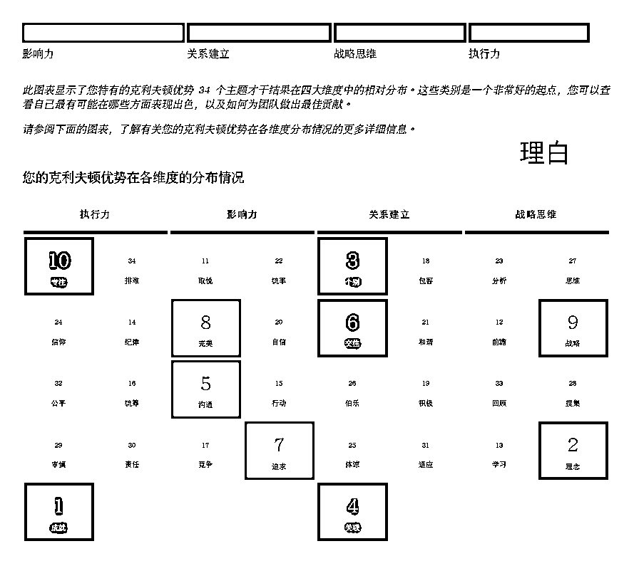
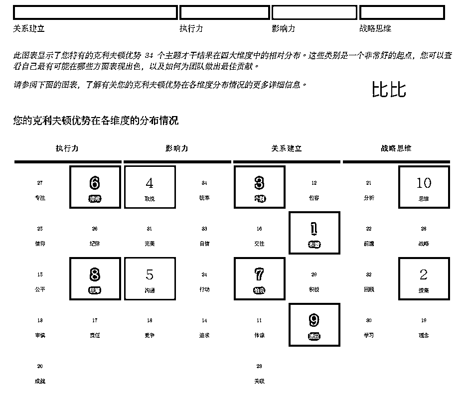

# 4.2.3 差异不等于阻碍 @醒醒同学

这次解读发生在感情升温的时候。表面上，两人没有特别难解的结，可心里多少压着一些没讲明的念头；有些想法，连他们自己都未必察觉对方竟然会这样看。趁早用才干报告做一次“预检”，能把磕碰概率降下来，也更容易摸到让双方都舒服的互动节奏。

**才干底牌一览**

理白四个维度的排序：影响力＞关系建立＞战略思维＞执行力

比比四个维度排序：关系建立＞执行力＞影响力＞战略思维

理白前十项：成就、理念、个别、关联、沟通、交往、追求、完美、战略、专注

比比前十项：和谐、搜集、个别、取悦、沟通、排难、伯乐、统筹、适应、思维

**盖洛普视角：互补、重合与落差**

互补面：确定关系前后、感情正浓那阵，理白的影响力更抢眼，关系建立排在其后；比比则是关系建立在前、执行在后。整体上，理白更像先迈步的人。理白眼中，比比温和、体贴、会照顾情绪（个别、和谐、取悦、沟通）；比比则容易被那股利落创意和事业冲劲吸引（战略、理念、成就、专注）。比比夸得越真诚，理白越能感到自己被认真看见（追求）。偏事业与偏生活的组合，反而很落地。

重合面：两人在“关系建立”这一维都排在前列，说明都把关系看得很重；个别这一项也靠前，天然容易注意到对方身上的独特之处，常冒出“我挺懂你”的笃定；沟通与取悦同样靠前，交流多、话说得甜，亲密感容易升温，小疙瘩也不容易留到隔天。

落差面：理白成就1、专注10、完美8，比比成就20、专注27、完美31。理白会把不少心力砸进工作，标准也抬得高；比比未必把职场当成人生头等大事。两人节奏能否同频，或者能否做到互不硬管，很关键。比比的排难、和谐、审慎、适应略靠前，自信、积极、交往靠后，行动上更被动。理白这边，交往、专注、成就、追求都排在前排，只要认定对方值得，就会主动把关系往前推；可比比容易本能地琢磨：他为什么对我这么好？我凭什么被关注、被爱？（排难会让人习惯性盘问题）理白在追求、成就、交往上同样靠前，关系越近越舍得付出，同时骨子里盼着被肯定（追求）；他也很在意事情有没有收尾，收不了尾会难受（成就），消息没及时回就容易受挫，甚至怀疑对方是不是一样在乎自己。当一方还在权衡是否进入关系，另一方可能已经把沉默读成冷淡，误会就这么冒出来。理白更愿意公开表达关系，喜欢让身边人知道自己的选择；比比面对这种外放可能略感局促，公开尺度需要提前商量。

**三处可以下功夫的地方**

其一，“沟通”与“个别”这组搭配。两人肯聊是好事。解读之后，他们试着用认识自己的方法去认识对方，主动探问对方怎么想，再给到对方真正需要的东西。比如比比更主动表达喜欢，理白也不催，按比比舒服的节奏来，口角变少，体谅变多。

其二，维度上的互补。理白擅长描画未来，也很把这段感情当回事，愿意为蓝图落地投入心力；比比能感到自己被郑重对待、被托住。比比有耐心、松弛感强，理白抛出的种种设想，他大多能稳稳兜住，这让理白在关系里获得“我这样挺好”的确认。前提是两人的生活节拍别差太远，不拿自身尺度去要求对方，不强迫对方改道；承认差异存在，并肯花心思读懂对方，双方就更容易在关系里遇见更舒展的自己，也能借对方视角补上自己认知里的盲区。

其三，事后复盘。后来我问过两人：当初究竟看上对方什么？也替他们把不少没说透的心思转成明话。一旦聊开，双方才发现彼此脑子里还装着那么多自己原先不知道的版本，对差异也多了几分体谅，自然更愿意给对方面子与空间。他们还约定隔一阵就做一次关系回顾，如今配合度明显上来了。真正伤关系的，往往不是分歧本身，而是误把对方的沉默当成无所谓，明明用力很多却始终没走到同一条路上。愿意花时间弄懂对方、让对方被看见，再一起朝前走，这才是长久关系的起跑线。

