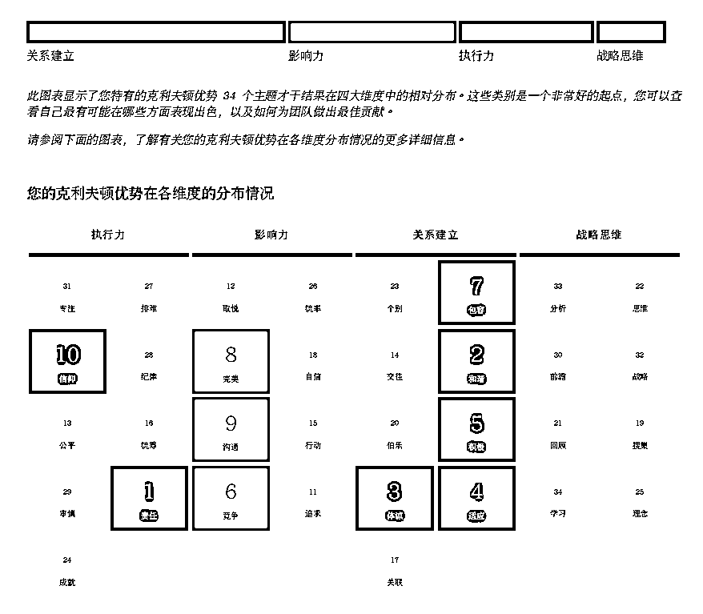

# 4.3.2 真实案例拆解：换一个职业环境，找到更快乐赚钱的方式 @醒醒同学

案例主角是保险行业的销冠叶子。她的特别之处在于，几乎从不主动推销，却有大量陌生客户主动找她买保险。有一段时间，她认为自己代理的产品性价比不够高，即便客户主动上门，她也选择拒绝，整整一年没有签单。后来，她跳槽到一家保险经纪公司，终于能为客户筛选出市面上最划算的产品，她瞬间动力十足，重新杀回销冠位置。

她的四大优势维度按顺序为：关系建立>影响力>执行力>战略思维。

她的前十才干是：责任、和谐、体谅、适应、积极、竞争、包容、完美、沟通、信仰。

🔥盖洛普优势解读（部分才干）：

• 关系建立和影响力排在前列，说明她天生适合在人群里绽放光彩。执行力和战略思维偏后，让她去过按部就班的生活，或者做研究型、事务型的工作，她会感到极度痛苦。

• 从才干组合看她的内在需求（部分举例）：
• 责任才干让她极度在意“被人信任”的感觉。如果一份工作能赚钱，但过不了良心这一关，她会异常煎熬。
• 竞争才干让她喜欢有明确的对手，超越他们拿到第一，她就会充满斗志。
• 完美才干驱动她追求更优质的方案、更优秀的自己和更好的结果。
• 积极才干让她非常看重人生的快乐感，这一点对她至关重要。

• 从才干组合看她的核心优势：
• 责任：她真心为客户着想并勇于担责，会尽力提供适配的方案，因此很容易赢得客户的长期信任。
• 积极+沟通+取悦：她特别擅长与陌生人破冰，在社群中发言亲和力强，乐于赞美他人，传递正能量，从不硬性推销。
• 完美：她懂得筛选客户，更愿意服务购买力强的人群，她所参与的社群往往也是高客单价圈子，这帮她打开了高净值客户市场，带来了大量流量。
• 竞争：一旦看到别人更优秀，她的胜负欲就会被点燃，会努力做到比别人更好，直到拿下第一，钱自然也就赚到了。
• 体谅靠前、专注靠后：她很在意客户的体验，所以绝不会强迫任何人买保险。

• 她遇到的难题，怎么破？
• 她想把自己的经验提炼成方法论教给团队成员，却总是提取失败：因为她天生擅长和人打交道，回答别人的销售疑问没问题，但不擅长“信息收集、知识整理”类的工作。她可以找一位擅长梳理框架的人来提问，由她负责回答，最后再整理出方法论。
• 做自媒体总不知道写什么？她更擅长通过大量面对面接触和沟通来获客（关系建立+影响力靠前），而不是靠内容创作来引流（战略思维靠后），所以多拓展社群人脉会更适合她。如果非要做内容，那就请专人帮她选题，她只负责回答，再由别人加工成内容。

总结：虽然每个人都想赚钱，但每个人爱钱的方式并不相同。有人更在意赚钱的过程是否开心，有人在意赚的是不是良心钱，还有人理想主义胜过赚钱本身。

看才干图时，排在最前面的才干往往反映了一个人内心最深处的需求和价值观。比如叶子，她无法违背“对客户负责”的本心，让她为了赚钱去做一件自己都认为不靠谱的事，那会非常痛苦。反过来，只要让她找到真正认可的产品，她的销售天赋就会瞬间爆发。
