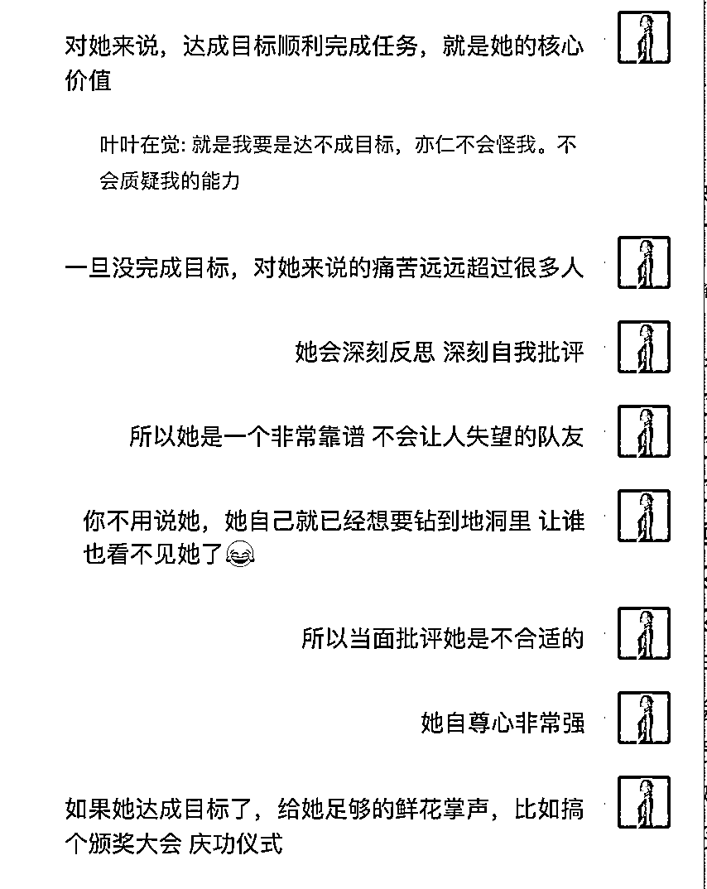
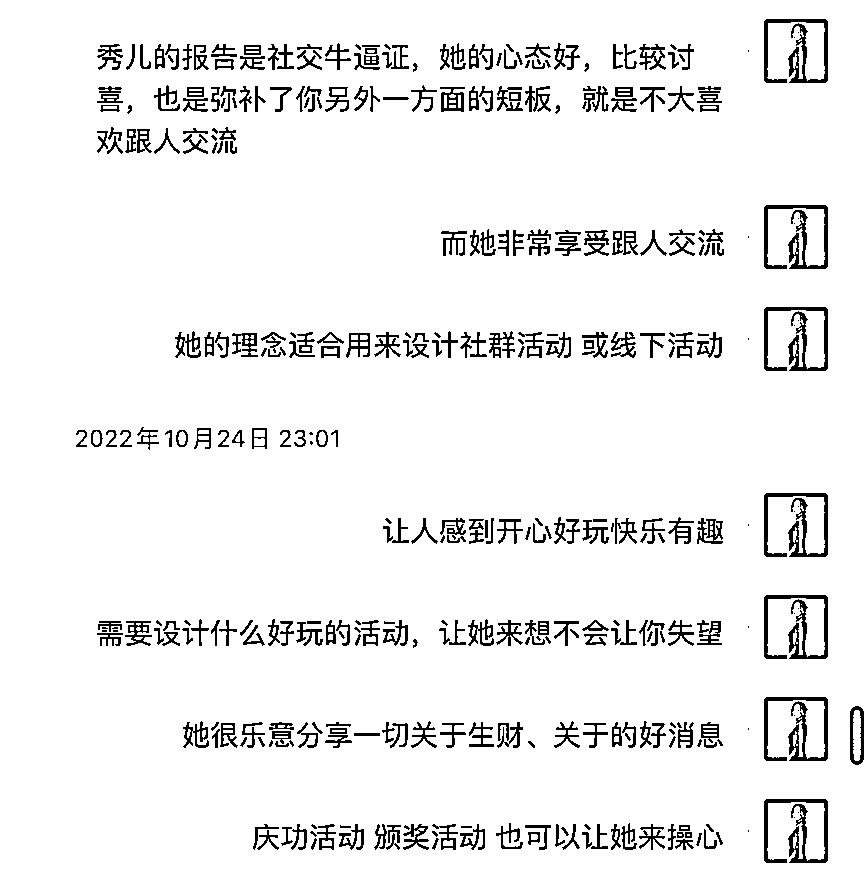
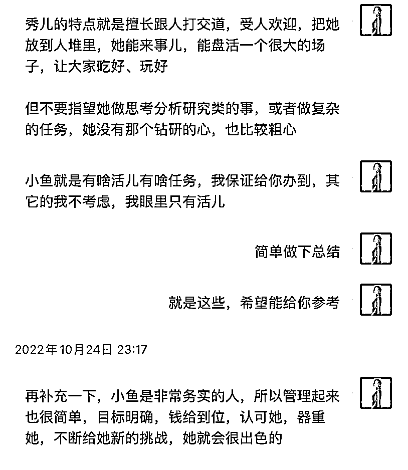

# 4.4.2 先看清成员优势，再谈有效激励

案例八：赚钱团队的盖洛普测评观察

赚钱团队此前安排全员做过盖洛普测评，并对结果进行了整体梳理。下面呈现的是当时部分成员的测评情况：

从这些信息可以看出，每个人的驱动力并不相同：有人格外在意目标能否完成，有人更愿意把时间花在与人沟通上，也有人偏向务实、关注落地。把成员各自的风格、强项和待补足之处看清楚，既能让团队配合更顺畅，也有助于成员自身成长。激励下属时，顺着每个人的优势与动机去沟通，往往比统一标准更有效。