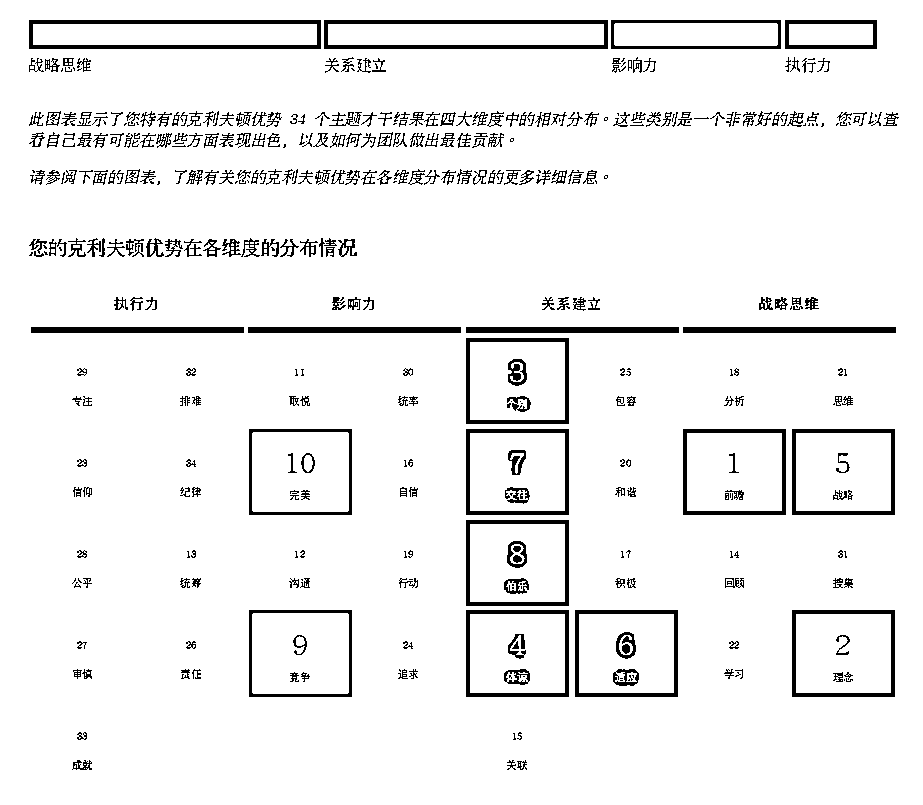

# 4.5.2 副业社群到底做不做？看这个案例就够了 @醒醒同学

案例的主人公是一位25岁左右的动画设计师，工作几年间先后换过几份工作，每次都能把副业项目从0到1顺利跑通。最近他在考虑要不要做一个副业社群，心里却没什么底，给自己定的目标是年入50万。

用盖洛普的四大维度来看，他的优势排序是：战略思维>关系建立>影响力>执行力。前十才干为：前瞻、理念、个别、体谅、战略、适应、交往、伯乐、竞争、完美。

盖洛普报告里值得关注的点不少：

他的战略思维和关系建立维度明显更强。找项目、拆项目是他的拿手好戏，0到1这条路径走得很顺。可一旦跑通了、新鲜感没了，他很快就会失去兴趣，更不愿意碰重复琐碎的细活。如果自己去做社群，就得反复带别人跑0到1，还要耐心回答各种细节问题，这对他来说很容易不耐烦，最终影响交付体验和口碑。

他对用户需求和新风口非常敏锐。别人已经跑通的项目里，他总能挑出那些能快速实现0到1的；如果项目还需要大量创意加持，他会更享受。加上他有视频创作的基础，短剧CPS、小说推文这类方向都可以尝试。但需要注意的是，他可能会经常更换项目，也容易习惯“赚短期的快钱”，大概率不会在一个方向上停留太久。

流量方面，他擅长用拆解项目来吸引人，战略思维用得很到位，情商也不错（个别+体谅+战略），还很会认识新朋友（取悦+沟通）。比起带人做项目——毕竟执行力不是他的核心优势——他更适合做商业拆解、引流获客，然后通过分销其他知识付费产品赚取CPS。

另外要留意的是，他对商机太敏感，看到好机会就忍不住想切换（前瞻+战略+适应靠前，专注+成就靠后）。习惯了赚短期快钱，再加上频繁换项目，如果做社群，很容易让用户跟不上节奏。

所以比较可行的方向是：他只做流量赚CPS，找善于交付、责任心强的人配合做产品交付；或者他主抓团队招募和流量增长，把具体交付交给更合适的人。

总结来看，复盘他过往的经历后，这些推测基本都能对应上。目前更适合他的路线，不是做副业社群，而是做内容、做流量，和有知识产品的人合作分销。这样能最大化发挥他的战略思维+关系建立天赋。

内容来源：[《盖洛普是什么？一个生财有术全团队都在用的工具》](https://wx.zsxq.com/dweb2/index/topic_detail/412584124411518)

