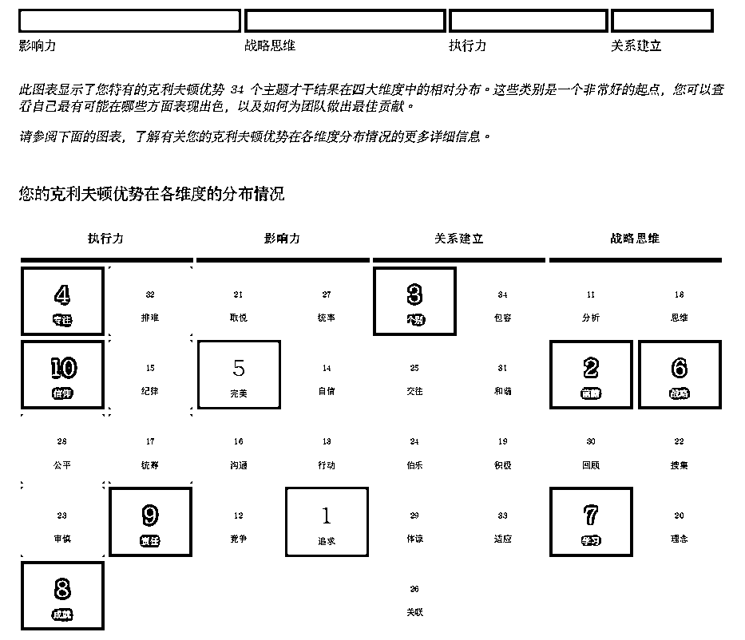
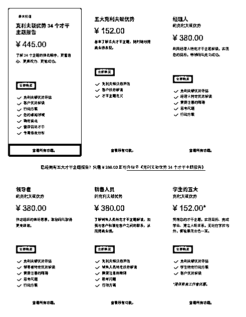
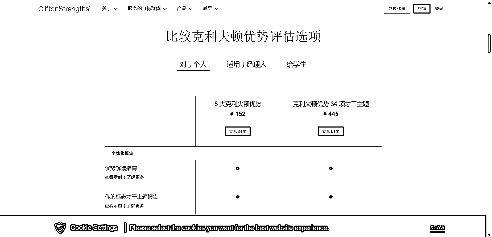

# 盖洛普测评，一篇讲清

盖洛普这些年的产品线不断扩展，目前已经形成七类测评。其中，“34项才干测评”属于必做项目，它的价值在于帮你辨认自己可能尚未意识到的天赋。其余六类分别有什么用途，官网有对照说明，可点 [👉「查找最适合你的克利夫顿优势评估」](https://www.gallup.com/cliftonstrengths/zh/253865/%E5%A4%87%E5%8F%97%E6%AC%A2%E8%BF%8E%E7%9A%84%E5%85%8B%E5%88%A9%E5%A4%AB%E9%A1%BF%E4%BC%98%E5%8A%BF%E8%AF%84%E4%BC%B0%E4%BA%A7%E5%93%81.aspx) 查看。

如果你已经下定决心做一次盖洛普测评，可以照下面五个动作推进：先领取测评码；再注册一个新账户；随后进入克利夫顿优势评估；接着正式开始答题；最后下载报告。

测评码的获取方式分两类：想拿优惠价，可以找教练代购；想按官方原价买，则去官网下单。

盖洛普对优势教练的认定已有成熟流程，本次航海中的教练均已通过官方认证考核。为方便教练开展工作，官方会向他们提供一些测评码优惠；这类折扣码只有盖洛普官方认证教练才能拿到，每年限额350个。

当然，你也可以选择其他购买途径。只要最终拿到正确、有效的测评报告，就能了解自己的盖洛普测评结果。需要提醒的是，不建议直接在浏览器里搜索“盖洛普测评”，搜索结果大概率会把你带到非官方广告。

正式开测前，请先把注意事项完整看一遍，并严格按注意事项操作。否则，可能给自己添上不必要的错误与麻烦。👉「② 盖洛普测评注意事项」

盖洛普优势测评也叫克利夫顿优势测评，正版官方入口为：[`login.gallup.com/`](https://login.gallup.com/)。在网上搜索“盖洛普测评”，会出现大量推荐，但其中大多数并非正版渠道，测评结果的偏差也可能不小。

截至2023年4月，盖洛普官方共有七类测评。其中，“克利夫顿优势34个才干主题测评”是必测项目，下文简称“34项才干测评”。这项测评能帮你发现自己可能具备的天赋。

（官方参考报告）

图中提到的“经理人”“领导者”“销售人员”等方向，其优势不需要单独测评；完成34项才干测评后，付费即可解锁对应的优势报告。

若你对其他测评也有兴趣，可以联系本次航海中的教练购买，同样有一定优惠。

（图片来自盖洛普官网）

本期航海主要采用“克利夫顿优势34个才干主题测评（CliftonStrengths 34）”。

它的作用，是把个人优势与弱点呈现出来，帮助你更清楚地理解自己的强项和短板，从而发挥出更好的表现，服务于自我提升与职业发展。

价格为445元，教练价410元。

报告内容包含34个才干主题的排名与详细解释，还会针对你的个人优势和弱点给出定制建议。

其他测评项目之间的区别，可前往官网查阅 [👉「查找最适合你的克利夫顿优势评估」](https://www.gallup.com/cliftonstrengths/zh/253865/%E5%A4%87%E5%8F%97%E6%AC%A2%E8%BF%8E%E7%9A%84%E5%85%8B%E5%88%A9%E5%A4%AB%E9%A1%BF%E4%BC%98%E5%8A%BF%E8%AF%84%E4%BC%B0%E4%BA%A7%E5%93%81.aspx)。

