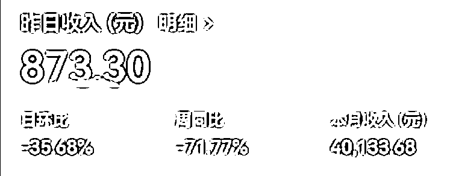
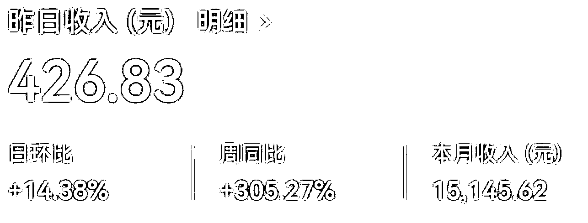
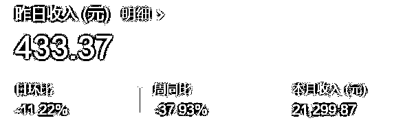
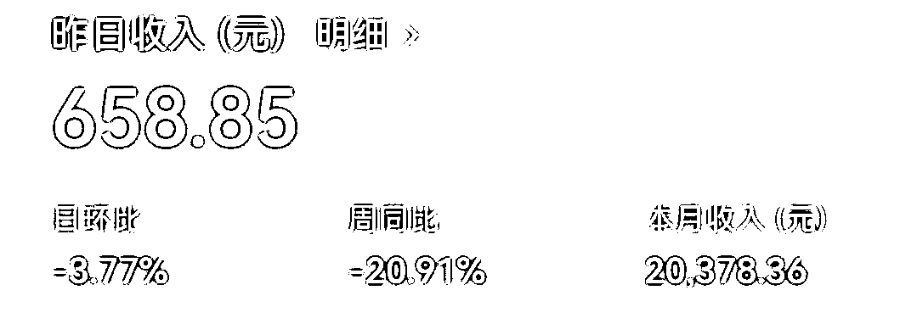
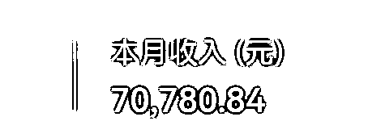
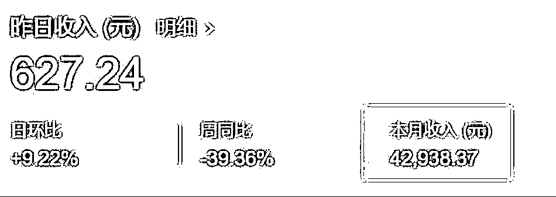
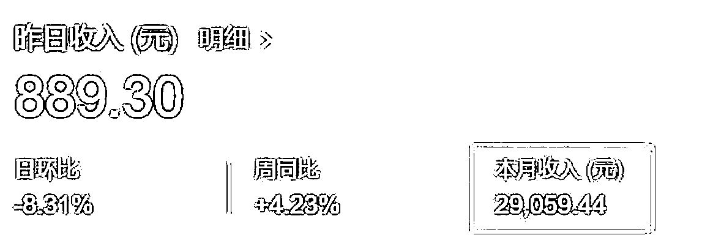
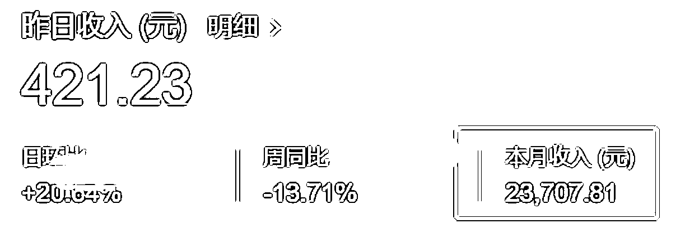

# 一、👸号写作，依然有奔头

社群里的 @渭水徐工 判断：2023 年的👸号依旧值得投入，机会和 2013 年、2016 年那会儿一样存在。

先看过去的成绩：单篇最高进账 7 万多元；月收入破万的学员有 120 人；收入超过 3000 元的超过 200 位；500 元以上的有 300 多位。不少学员此前完全没经验，第一次动笔，从零起步到拿到收益速度很快——第一期就有人 3 天入账 300 多元。从这些结果看，表现拿得出手。

反观近期头条、百家等平台，流量收益明显下滑，有人的单价跌了接近十几倍。👸号则是另一番景象：耗时短，一篇通常 1500 字上下，口述半小时、打字一小时即可完成；字数不多，流量单价却高，长尾流量也拉得长。因此，无论看收入、上手难度还是投入时间，👸号都是眼下自媒体里最容易起步、也最容易见到钱的方向之一。

下面放几张变现截图供参考。

注：上述收益均来自坚持日更的作者。

现在👸号的变现路径主要有两类：广告和打赏。广告是主流，分为自己接广告、商家主动来投、正文内带货、文末贴片广告；打赏则多见于 IP 属性较强的账号。具体操作可看「六、👸号爆文的变现方式」。

