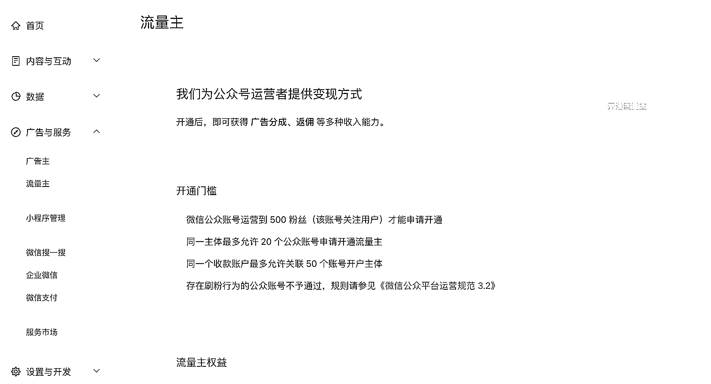

# 3.2 先把流量主开起来

公众号注册好以后，流量主功能的门槛是 500 位关注者。若想省时间，直接补齐粉丝来开通，是效率最高的方式，也不会给后续流量拖后腿。购买渠道并不难找，某宝上搜一圈就能看到不少，这里就不多讲了。

流量主开通后，先别急着做别的：用原创形式连续群发三篇文章，打赏权限随后就能解锁。账号名称、头像，最好和打赏页面展示的名称、头像尽量统一，这样账号人格会显得更可信。

接着把账号轻量布置一下：上传头像、设置昵称、简介简短写几句即可。到这一步，前期准备就差不多了。这些细节不必反复打磨，真正该投入精力的是内容；其余都属次要环节，千万别本末倒置。

