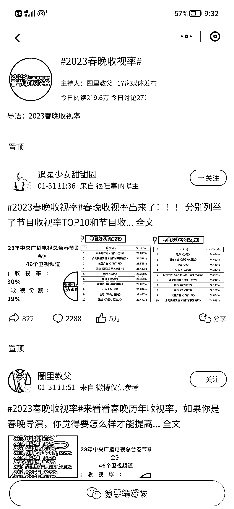
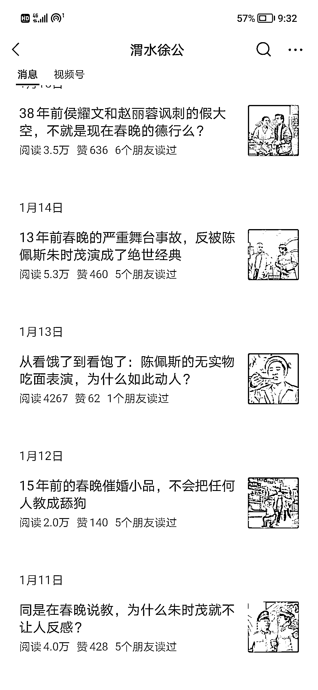

# 4.1.2 热点素材去哪挖？

做热点内容，找选题时绕不开几个常见榜单：🧣热搜、今日头条热榜、知乎热榜……这些平台通常能提供不少可写的话题。

不过，榜单上的内容未必完全反映真实关注度，其中可能经过筛选和包装。因此，看到热榜时得多想一步：大家真正在意的是什么？知乎上不少高赞回答明明流量很好，却很难登上热榜。这类内容反而更值得留意，也往往更容易做出爆款。

原因不难理解：那些回答是一个个赞积累出来的。即便没有热榜推荐，仍有大量人关注，说明它切中了用户想看的东西。我们挑素材，就该挑这种直击要害、有真东西的内容。

