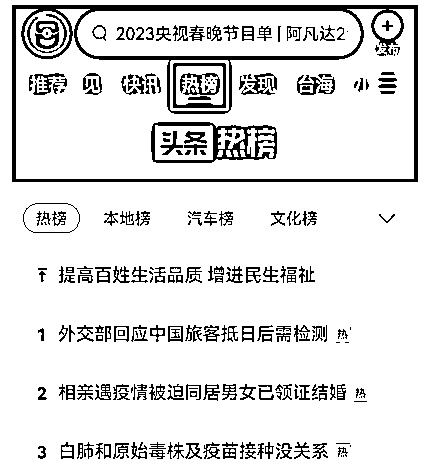
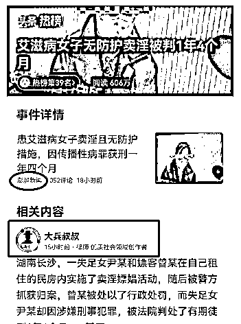
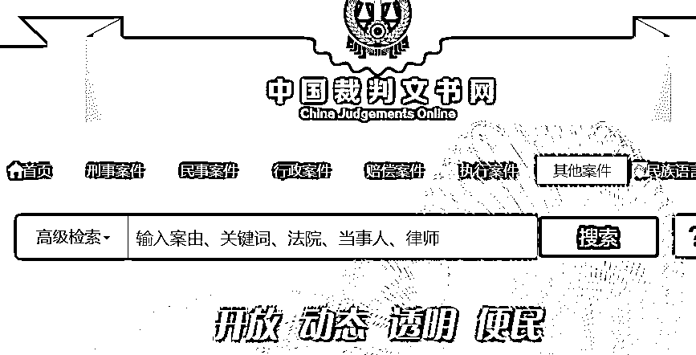

# 4.1.4 法律类素材去哪找？

写法律类稿件，第一步往往不是动笔，而是找对信息源。常见的新闻渠道里，北青网、1818黄金眼这类官方媒体值得优先关注；它们发布的内容通常可信度较高，也适合作为写作素材。

另一个重要入口，是头条新闻热榜以及地方热榜。

打开热榜中的具体条目，通常能看到官方媒体的报道。例如“艾滋病女子卖淫无防护被判刑”这一热点，背后就是澎湃新闻的报道。大家不妨顺着热点去关注澎湃新闻；遇到其他话题时，也可以点进详情页，留意对应的媒体账号。久而久之，就能积累一批可用的媒体来源，日后查资料会方便很多。

热榜条目下方，还常有不少法律从业者围绕事件撰写的文章，可以作为参考。需要提醒的是，一些律师账号会明确标注“抄袭必究”，比如大兵叔叔。可以参考他的行文思路，但绝不能照搬照抄；否则头条可能把作品判为相似内容，只推荐给粉丝，甚至还可能遭到原作者投诉，实在不划算。

第三个素材渠道是裁判文书网。

这里收录了大量已经宣判的案件，完全可以当作写作资料来用。不过要注意，涉案人的具体姓名必须做模糊化处理，不能直接把真名写进文章。这样既保护了当事人，也能避免对方投诉。

