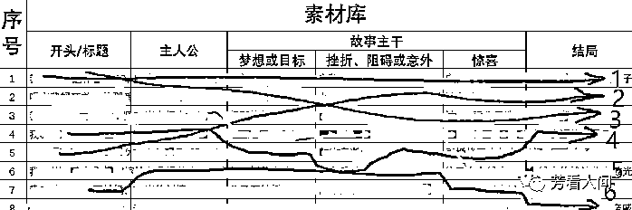

# 4.1.6 建好素材库，写故事不卡壳

素材渠道打通后，可写的东西会源源不断。接下来要做的，是把它们分门别类放进一个随取随用的库；写作时挑合适的料，拼成一篇即可。

以情感类为例。可参考的账号有写故事的刘小念、陈若鱼、猪小浅——都写故事，但路数各有差异。看她们的内容，既能学写法，也能顺手攒故事和爆款标题。正文模板在「4.3.1 情感类：爆文模板」里还会展开。

情感故事的骨架可以记成四块：题目、主角、主线、收尾。主线再拆成三截：心愿或目标；阻碍、挫折或意外；惊喜或反转。换成大白话就是：谁想干什么，为什么干或怎么干，途中撞上什么，最后落到什么结果。

动笔前先定主题、拟标题，再顺着主题往下写。主角部分，先交代“我是谁、多大、来自哪里、做什么”，再简单说明身边相关的人或物：什么关系、怎么认识、做什么。主线写目标与梦想，也写挫折、阻碍和意外。收尾写这件事对主角的影响、主角怎么做或该怎么做、结果如何。这样，故事就成形了。

生活里、文学作品里、小说影视剧里、热点新闻里、各平台刷到的内容，怎样反复利用？先分别建六个库，建好后交叉调用，很快就能搭出一个故事。

1、标题库：刷到让你忍不住点开的题目，立刻收进去。比如“66岁退休金8000、儿孙满堂却不想活”“听完母亲临终那番话，我这辈子不结婚了”“和堂哥地下恋20年，结局出人意料”“68岁大病一场才懂，有些东西比亲生孩子更可靠”这类有异常、有钩子的标题。

2、主人公库：新闻、报道、八卦、小说影视、身边真事里的人物，都可以存进来。例如18岁未婚当妈的小佳、患不孕症的小爱、40岁不结婚却仍有女人倒追的老光棍、55岁生三胎的大妈、50多岁再婚还要100万彩礼的大妈——有异常、有争议的人物更抓眼。

主线库其实包含三个小库：

3、梦想或目标库：不孕夫妻想生娃、结婚想买婚房、大爷想找老伴、重男轻女家庭二胎想生男孩、想开美容院等。

4、挫折、阻碍或意外库：多年恩爱的夫妻始终怀不上且查不出毛病、房租突然涨价、谈了几年的对象因彩礼房子被父母反对、跳舞时突然中风、感情很好但一方卷钱失踪、相伴多年伴侣突然提离婚等。

5、惊喜或反转库：老家拆迁得钱得房、女方父母把50万彩礼突然降到8万、失散多年的儿子开宝马回来、多年不孕的女人三年后突然怀孕、房东突然减免房租等。

6、结局库：来源同上，把人物最后的归宿记下来，好坏都行。比如复婚、离婚、一家人幸福生活、儿子接她养老、找到合适老伴安享晚年、住进养老院、夫妻更恩爱等。

六库齐备后，几分钟就能讲出一个故事。比如把主人公库1、目标库5、挫折库2和4、反转库5、结局库3串起来：小佳18岁未婚先当妈，她想开美容院，手里只有8万，看中月租7万的店面，房东却要9万；她正想放弃，房东突然中风，子女不愿出钱治病，急着把店租出去，降到6万租给她；8年后美容院做成连锁，孩子父亲也回来找她，一家人幸福生活。这样一波三折的初稿就有了，还带真实感，容易让人共鸣。

若不想写故事，想写观点鸡汤文，就用小故事加观点、名言、金句：一般三个小故事，每个故事后接观点、名言、金句。那就在六库之外再建一个观点、名言、金句库，齐活。

故事有了后，再补细节、对话、动作、心理活动，就成有血有肉的故事文。情节要曲折，起承转合要足，太平淡抓不住人。素材库用顺了，一天写10个故事也不夸张。想用一个库写出N个故事，就把主角、目标、挫折意外、惊喜、结局打乱重组。比如小佳那篇用了152453，也可用12345或22335，稍作调整即可。

再举个简单例子：主角2是小爱，26岁，财务；其他人物小王，29岁，业务员，两人是夫妻。目标1：想生孩子；挫折1：结婚三年没怀上；他们看医生吃药都没用，认命不治；反转4：一年后意外怀孕；结局7：夫妻更恩爱。组合起来就是：我叫小爱，26岁做财务，老公小王29岁跑业务。结婚三年多一直想要孩子，没避孕也没怀上。看了很多医生、吃了很多药也没用，后来认命不治，没想到一年后意外怀上了。这只是雏形，字数少也不够抓人，要往里填细节和情节，越曲折越好。

填完故事，再加观点和信息量，也就到结尾了。写完@自己一下，补总结观点或感悟，再抛问题给读者：可以问认不认同你的观点，也可以问对故事里的事怎么看。小爱这篇可给观点：怀不上孩子的夫妻别放弃，积极就医、放松心情，奇迹仍可能出现。问题可以问：你身边有不孕不育的夫妻吗？后来生了吗？总结观点、感悟和问题不能少，能引鸡汤、名人名言、影视书金句更好。

以后看电影、新闻、书、剧、视频时，记得把有意思的标题或开头、主人公、梦想目标、挫折阻碍意外、惊喜、结局这六个要素提出来，分类入库，用时直接取。收集素材像逛超市，喜欢什么菜就放购物车；整理建库像买菜回家分门别类放冰箱，做饭时随手拿；写故事像炒菜煲汤，胡萝卜玉米马蹄骨头能一起煲，也能换别的搭配。众口难调，多试几次才知道读者爱吃什么。

主干和情节要详略得当：与主题无关的略写，能体现人物性格、推动故事的详写。结尾尽量反着来，让读者有意料之外、情理之中的感受。主线多写动词、多用大白话，少堆形容词；用连贯动作制造画面感和代入感，让人身临其境、产生共鸣。语言要简练，比如“月工资100元”“一个月挣100块”，带入场景，多用动词加名词，多用转折词、连接词。

重要的事情说三遍：别抄，别抄，别抄——标题也一样。可以模仿思路，但必须自己动脑改。内容尽量贴近生活、温情、正能量，别太狗血暴力；有违公序良俗、乱伦、色情的内容千万别碰。

我建库用Excel，再导入印象笔记，表格看着直观；你习惯用什么工具就选什么。

上面这张图就是我的素材库。里面的条目彼此交叉、重新搭配，能变出很多不同故事；60个素材够写一年，当然收集得越多越好。
