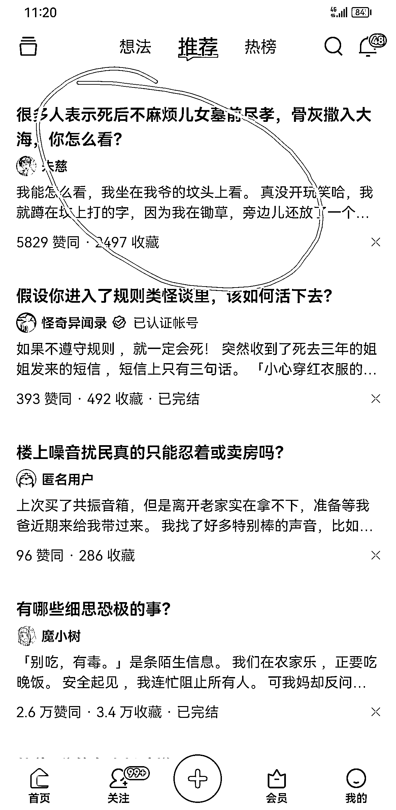
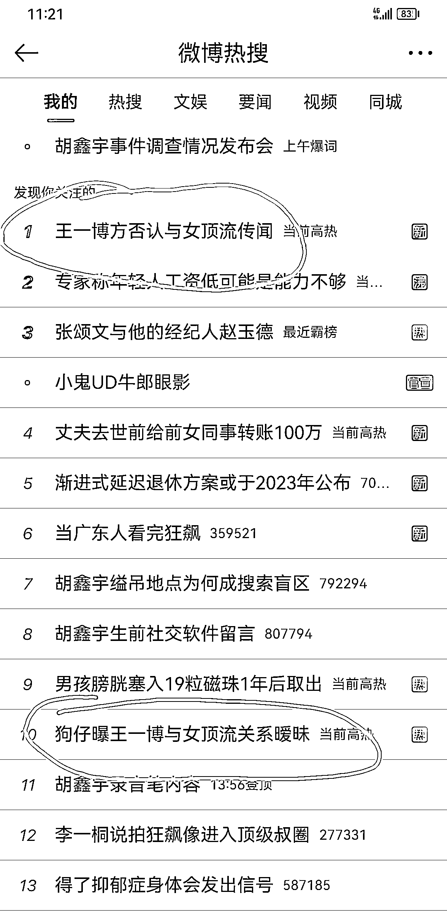
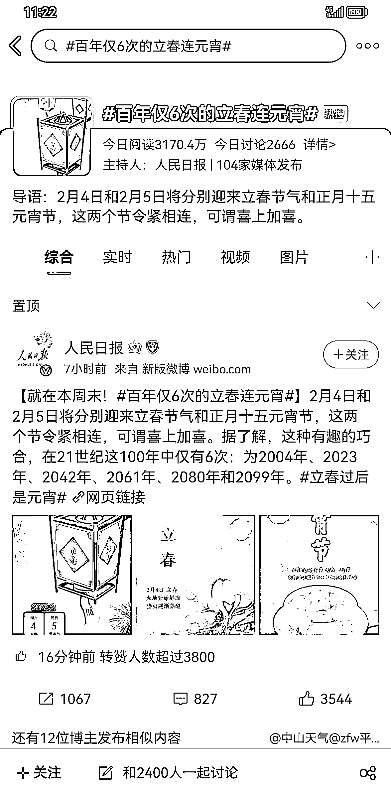

# 4.2.2 热点选题：按类型找爆点

做热点内容，第一步通常是从各大热榜里找题。我平时看得最多的是微博热榜和知乎热榜，不过落到不同细分热点，选题侧重并不一样。

**指点江山型**，主打对当下社会不公事件的批评，受众以中老年男性为主。这个方向做选题，知乎热榜比微博热榜更合适：知乎对负面社会新闻的呈现更充分，微博榜单的修饰感偏重，曝光力度也弱不少。还要留意一种情况：知乎上不少爆款回答明明有流量，却未必登上热榜。这类内容通常比榜单题更尖锐，成文后更容易出爆款，因为它们是读者一票一票顶起来的，说明情绪已经被充分调动。选题时要找的，正是这种够锋利、够扎心的内容。优先级可这样排：知乎自然爆款第一，知乎热榜第二，微博热榜第三。

**娱乐热点型**，追的是当下娱乐焦点，读者以中青年女性为主。这个方向对多数作者来说，微博热榜几乎压过一切。最好一天多刷几次微博，留意热榜标识：带“热”的可以备选，带“沸”的要优先做，出现“爆”的不但要优先，还应尽量当天出稿，否则流量会掉得很快。优先级从高到低是：饭圈小道消息、微博热榜、知乎热榜。

**养生热点型**，做的是科普知识内容，受众是不分性别的中老年人。这里说的“养生”，和大众通常理解的养生并非一回事，素材多来自老话，比如“立春三不吃两不喝”这类说法。老年读者对死亡和疾病的焦虑较重，这类内容往往能带来可观阅读量。操作时，一方面结合农历节气，另一方面从热榜里挑健康相关题目；写作时只把落点放在传统习俗上，医学建议一句都不要给，不然会触碰严重违规红线。排序上，节气内容应不低于微博等平台的健康类选题。

其他热点亚种我接触不多，之后再慢慢摸索。
