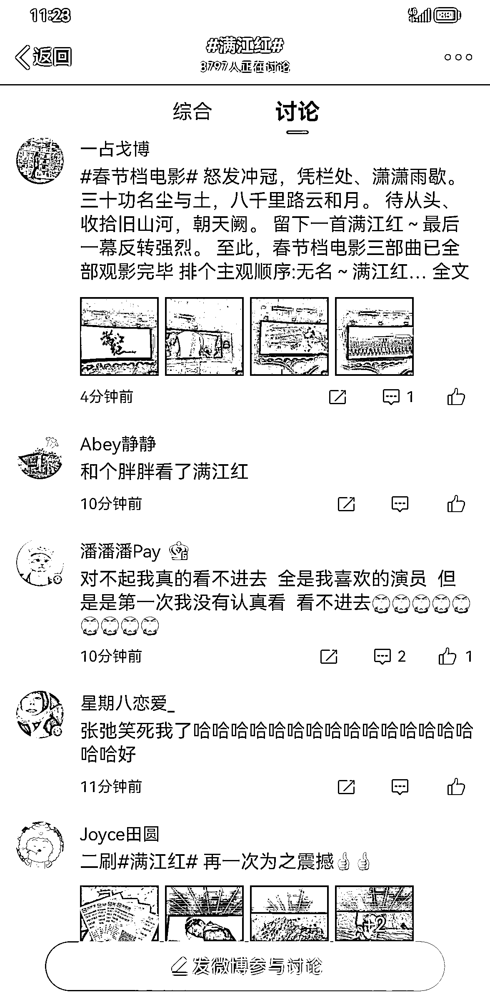

# 4.2.3 剧评选题：两条路就够

做剧评，选题其实不用想得太复杂，方向基本就两个。

第一条路，是借热播作品做文章。拿《满江红》来说，影片上映后讨论度很高，口碑也有明显分歧。此时围绕它写五六篇、七八篇切入角度新鲜的评论，就有机会接住这波关注度。

第二条路，是回头挖经典剧。像《知否》《甄嬛传》《大明王朝1566》这类作品，本身关注基础就厚，可解读的信息也密。一个不起眼的小细节，往往能延伸出不少内容，持续写下去选题并不容易枯竭。说得直接些，单靠一部剧产出几百篇，也不是难事。

这两条路，都能当成你的选题方向。

