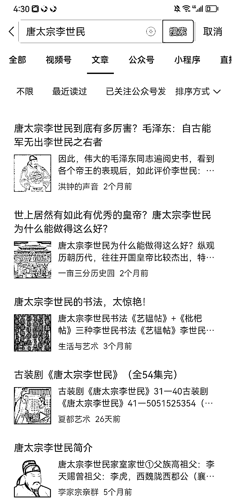

# 4.2.5 历史选题：追热点，或写所爱

做历史类内容，选题并非只有一种方式：既可以借当下热点找切口，也可以守住自己的兴趣，按个人思路稳稳地写。

先说借热点。想走这条路，平时就得留意舆论场上的新动向。比如“胡歌生女”这类引发广泛关注的消息，也能启发我们去寻找历史上重要人物出生或添丁时同样造成轰动的例子。不过，热点与历史之间的贴合度必须足够高，经验尚浅时最好不要贸然下笔。

再如，某地县长贪腐的新闻，可以延伸为古代官员贪污会面临怎样的惩处；“明星与粉丝”的话题，也能落到古代追星族的狂热举动上，《大宅门》中白玉婷与尚筱菊照片成婚的情节，就有真实历史原型。

要提醒的是，用热点切入历史，事件之间的契合度必须非常高；由当下观照古代，也很考验作者的笔力。写作基础暂时不足时，不妨先放一放，在之后的练笔中逐步为自己积累加分项。

另一条路是常规写法：围绕自己真正感兴趣的人物和事件展开。写作首先图的是写得痛快，可以选自己敬佩的人、反感的人、令人惋惜的人，也可以是让人落泪的人。

选定对象后，先定下情感与判断的底色，再梳理其事迹，人物轮廓就出来了：是敬佩、同情、肯定，还是功过并存，只要全篇沿着这条主线走，通常不会跑偏。写隋炀帝，大多绕不过劳民伤财、施政暴烈、急于求成等侧面；写唐太宗，则可以从善纳谏言、宽仁待民等方向为他增色。

遇到史料很少却格外喜欢的人物，不妨从他的先辈、后裔、亲友等旁支材料切入；必要时可以做适量虚构，但别假得离谱，虚构的情节仍要服务于人物真实的性格逻辑。

