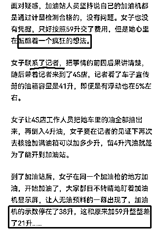
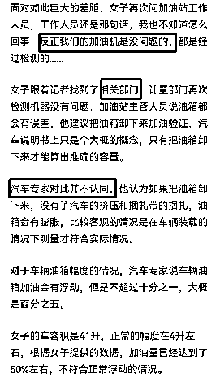

# 4.3.4 法律类：新闻爆文七步写法

想把法律类新闻写成爆款，可以记住一条七步口诀：先点地点、再抛冲突、交代新闻、汇总网友声音、解释法律、给出应对、引导互动。整篇篇幅控制在1200至2000字之间，最多不要超过2000字。

接下来，就按这七个环节逐一拆解。

第一步是点明地点。省份和城市要写出来，最好具体到地级市，一般放在开篇第一句，简短交代清楚即可，常见写法就是“近日，X省X市”。

第二步是抛出冲突，这相当于开篇就给读者一记强刺激。位置要放在第一自然段的前50至100字，紧跟在地点之后。先想清楚这条新闻最核心的矛盾是什么，再换到读者角度琢磨：怎样用几十个字，让人一看就血压升高？这就是“列冲突”要完成的任务。

来看一个传播量达到千万级的案例：近日，山东菏泽一名女车主加满油后当场愣住——油枪显示加了59升，可她这辆车的油箱最多只能装41升，而且加油前箱内还剩7到10升。面对质疑，加油站工作人员却表示没有问题。女车主一气之下，把车开到4S店，做出了一个让人意想不到的举动。

开头除了常见的“近日，X省X市发生某事”，也可以直接用情绪化表达抓住读者，比如“令人发指”“太残忍了”“严惩不贷”“太坑人了”“太猖狂了”。

不过要提醒一句，像“残忍”这类词如果用得不当，可能带来一定风险。

第三步是讲新闻。用400至800字把事情的来龙去脉说清楚，这一段可以放慢节奏。语言要朴实、生动，像跟熟人聊天一样，别写成官方书面语。另外，这里不要用插叙、倒叙，否则读者容易看不明白，一旦跳出文章，后面篇幅就白费了。

叙述过程中，可以适当加入能制造波折、吸引眼球的词语，比如“酝酿着一个疯狂的想法”“目不转睛”等。还可以从多个角度推进，比如当事人联系记者、联系相关计量部门、咨询汽车专家，让读者愿意跟着你的思路往下看。

第四步是网友看。篇幅安排在200至300字。可以从新闻账号评论区挑几条高赞留言放进去，这一步比较简单。网友观点既可以找爆款评论区里评论量高的说法引用，也可以自己归纳编写——反正是网友说的，对错难以查证，只代表网友个人观点。角度上可以正面、反面、中立面都兼顾。最后再补一小段自己的简短看法，这样既有别人的声音，也有自己的判断，整体就比较完整。

第五步是说法律。这里特别强调：即便你没有法律从业资质，只要援引的法律条文没有问题，同样可以写出爆款。平时要多了解一些法律知识，多刷知乎上的热点问题——很多答主会替你列出法律条文，省去自己查找的功夫；也可以存一些电子版法律资料，到时按关键词检索对应律条。这一步看着难，但在信息时代，掌握最基础的检索技巧就不成问题。这一段同样安排400至800字。

简要列完法律条文后，还要跟上对本案、本事件的具体分析，以及依据相关条文应当如何处罚。

第六步是怎么做，也就是告诉读者遇到类似窘境时该采取哪些行动。位置放在倒数第二自然段，几句话即可。如果觉得前面叙述不够，或者字数不足，这里还可以加入自己的亲身经历，分享遇到类似事情时是怎么处理的；如果没有发生过，也可以自行编撰，目的就是引发读者共鸣。

第七步是引互动，放在最后一段，留两三个问题诱发评论区讨论即可。

