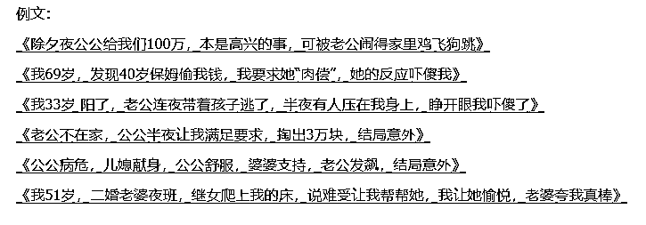
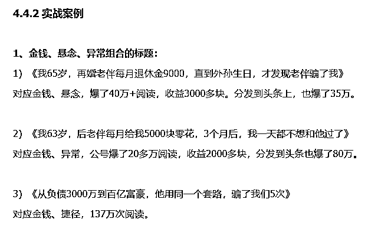
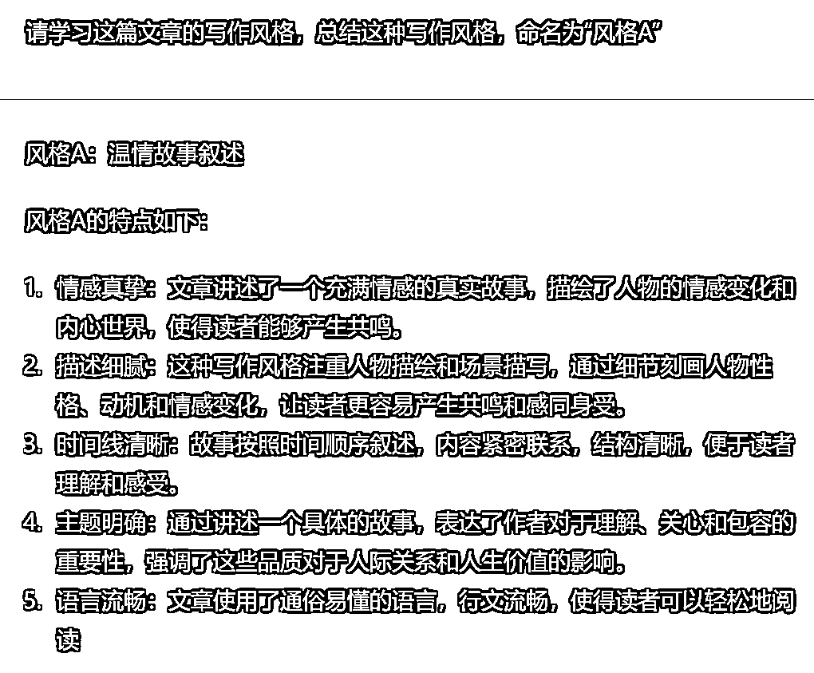
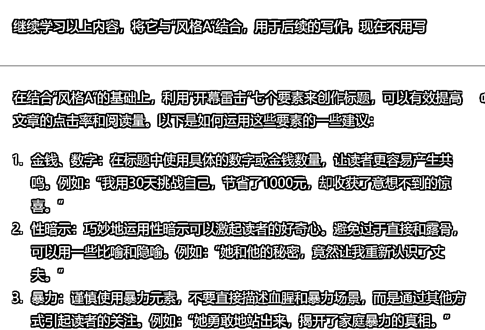

# 5.1 调教文风

先翻到手册，把「4.3 如何写好文章正文」里的爆款模板，连同「4.4.2 实战案例」中的爆文样例一起找出来，全部丢给 ChatGPT，让它先“吃透”这批素材。

除了手册里的内容，也可以去公众号挑几篇高质量文章当范文喂进去，让 ChatGPT 继续揣摩。

prompt:
请仔细阅读这篇文章，分析它的文风特点，归纳后将其命名为“风格 A”
text: """ 文章内容放在这里 """

这里建议用 `text: """ """` 把文章原文包起来，这是 OpenAI 官方的推荐做法，目的是让 ChatGPT 能明确区分“指令”和“待处理文本”。

另外要注意，喂给它的文章别太长，不然 ChatGPT 容易报错。公众号爆文的长度一般就在 1200 字左右，这个体量基本没什么问题。

等它把风格总结完毕，再让它把这套风格真正吸收进去，完成调教。

prompt:
请继续学习上面的内容，将它与“风格 A”整合起来，用于之后的写作；现在先不要实际动笔

