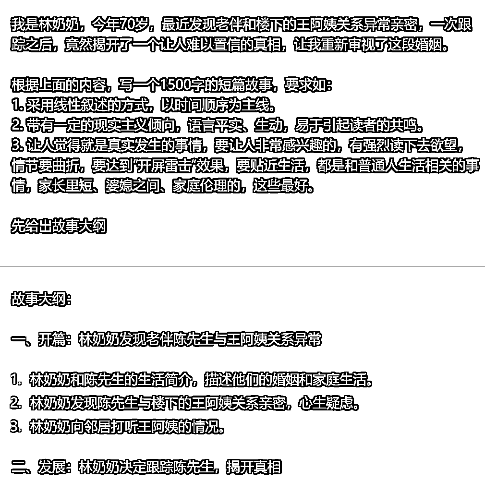

# 5.3 先搭骨架，再落笔

想让 ChatGPT 按你的选题写出一篇短篇故事，别一上来就催它直接交稿。更稳妥的做法，是先让它把故事大纲列出来；如果框架不合心意，就继续提意见，反复调整，直到你点头为止。

可以这样向它下指令：

“选题内容”

请围绕上面的主题，先构思一个约 1500 字的短篇故事框架，并只输出故事大纲。具体要求如下：1. 故事按时间先后推进，采用线性叙事；2. 整体偏现实题材，语言朴素鲜活，容易让读者产生代入感；3. 读起来要像身边真实发生的事，并且能勾起强烈追读欲；情节需要有波折，开头最好具备“开屏雷击”的冲击力；4. 内容贴近普通人的日常生活，优先考虑家长里短、婆媳关系、家庭伦理这类题材。

