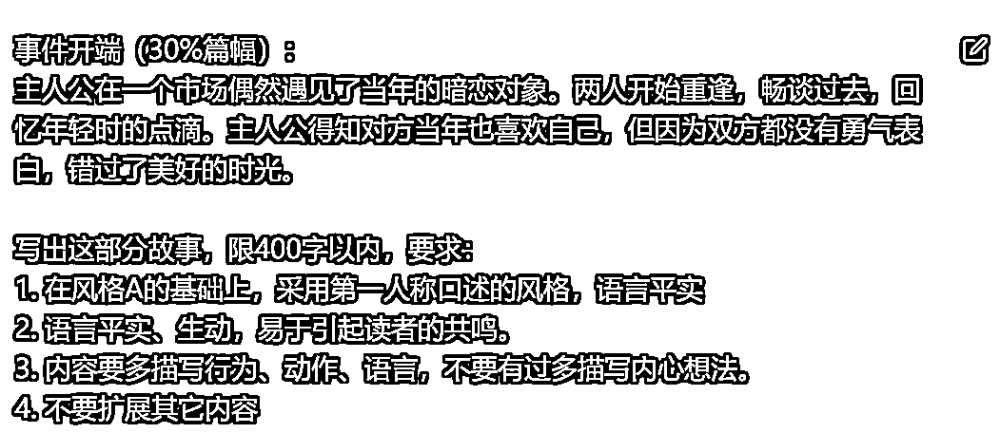

# 5.4 正文写法新思路

相信很多人都有体会，让ChatGPT直接产出文章，翻来覆去就是那几套模板，要么“1、2、3”罗列，要么“首先、其次、最后”一路排下去，读起来特别生硬，像流水线上的东西。要是抱着省事的心态，全部交给AI自动写，或者用工具批量生成，最终效果往往很一般。

与其指望它一口气吐出一整篇，倒不如换个思路：把文章拆成几个板块，针对每个板块给出明确要求——比如重点写什么、篇幅多长、风格怎么定。等各段都按规格写好了，再拼接到一起。这样做出来的内容，原创度差不多能到60%。

下面这组提示词，可以拿来直接参考：

- 开头部分（约占全文30%）：填“主要情节”
- 落笔要求：这段内容控制在400字以内；沿用风格A，用第一人称来讲，语言尽量朴实；表达要生动，让读者有代入感；多写动作、行为和对话，内心戏少碰；其他无关内容一概不写。

