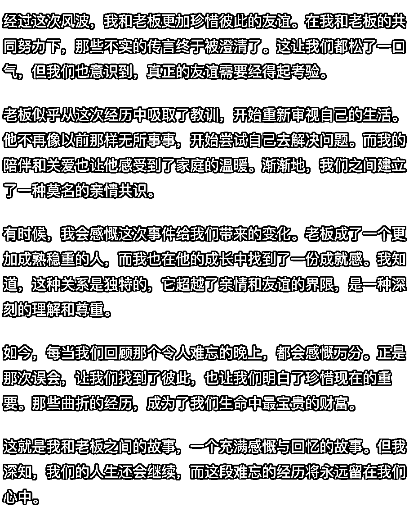

# 5.5.2 别让结尾拖后腿

ChatGPT 产出的文章，收尾常常铺陈过多、套话连篇，读起来不够干脆。下图就是一个典型例子：

所以，这部分得靠人工再打磨。做法并不复杂：从收尾中保留两到三段有实际信息的内容即可；如果前后衔接不自然，顺手调整几句，几分钟就能改好。别看结尾没有标题和开头那么关键，它同样不该拖泥带水。

上面那段压缩之后，可以变成类似下面的表达：一场风波过去，我和老板的友情反倒更牢固了。我们合力澄清了不实传闻，彼此都松了口气，也明白真正的情谊必须经得起考验。再回望那个难忘的夜晚，我们仍会感慨：正是那场误会，让我们重新看见对方，也学会珍惜当下。那些波折，最终成了生命里珍贵的积累。

也不用担心删减后字数不够。去掉冗余内容后，篇幅通常仍能保持在 1200 字以上。

