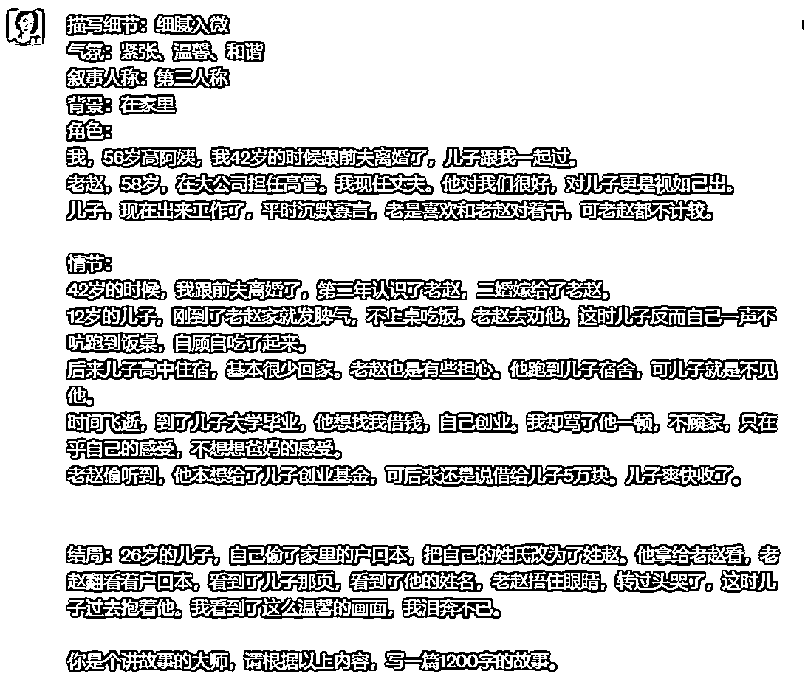
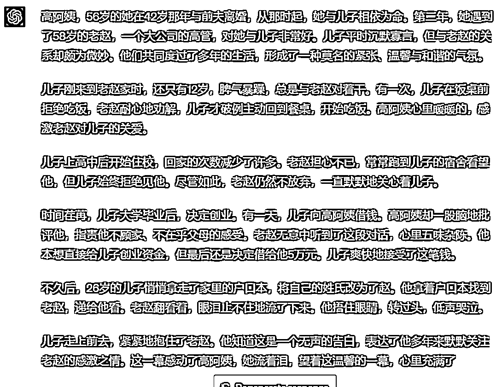
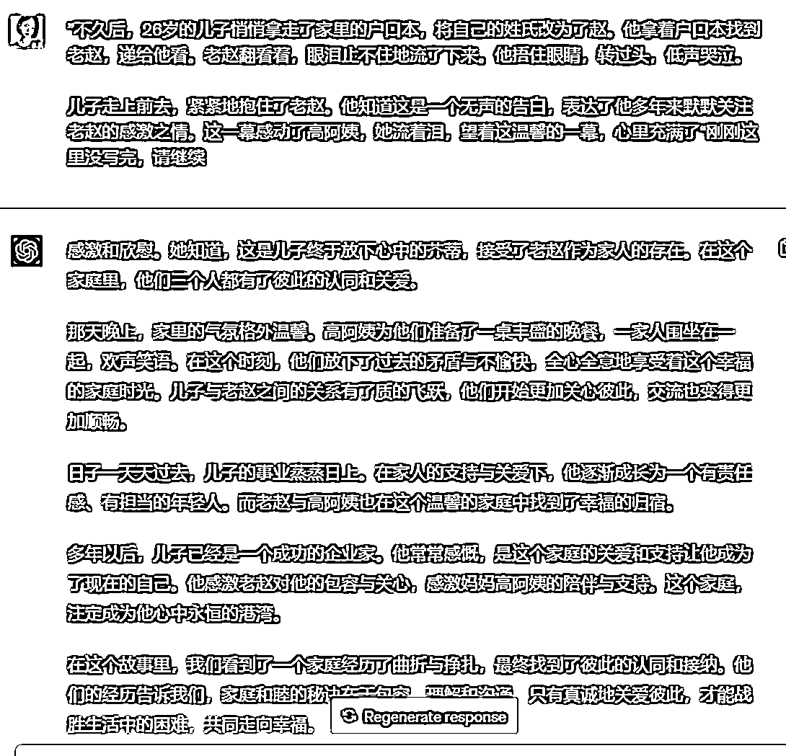
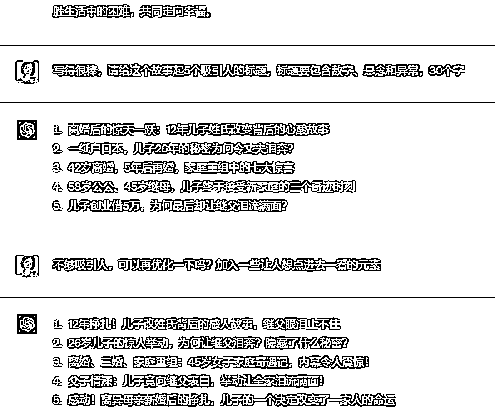
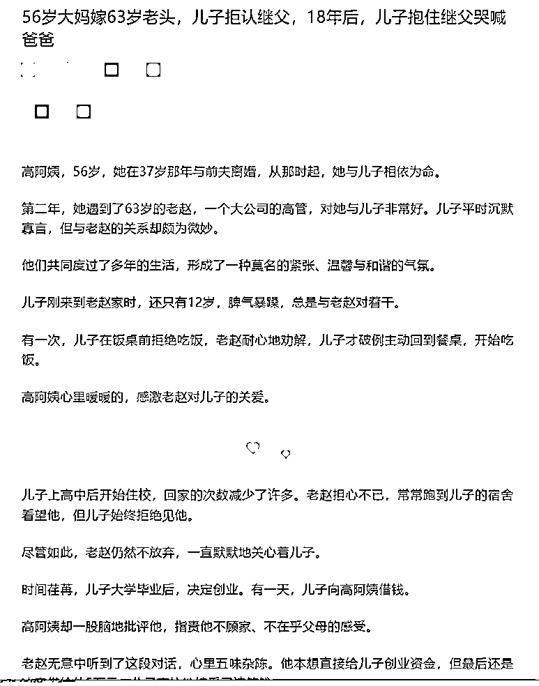

# 5.7 想快速出稿？试试把 ChatGPT 用起来

出稿要快，或者稿件需求量大，@小女子 老师的方法值得参考。

前提是选题已定（详见「5.2 找选题」）、大纲已列（详见「5.3 写大纲」），再把日常积累的素材库（详见「4.1 如何搭建素材库」）调用起来。之后，把选题、大纲和你的具体要求打包交给 ChatGPT 就行。

提示词可以这样给：
描写细节：气氛：叙事人称：背景：角色：情节：结局：你是个讲故事的大师，请根据以上内容，写一篇 1200 字的故事。

ChatGPT 单次回答的字数有限。要是它没写完，让它接着往下写即可。

提示词：
“前文结尾内容” 刚刚这里没写完，请继续。

标题方面，先让 ChatGPT 出一个基础版，再依照前面讲过的「4.4 如何写好文章标题」自己动手润色。比如最后改成：《56 岁大妈嫁 63 岁老头，儿子拒认继父，18 年后，儿子抱住继父哭喊爸爸》。

正文润色可参考「4.5 爆文写作自检方向」：重新调整段落，把不够口语的句子改顺，整体几乎不用大改，就能发布。

就这样，一个故事便成型了。最终成文效果如下图：

一篇文章能迅速完成，关键在于自己的素材库里备好了情节大纲；一小时写出十几篇并不夸张。

当然，各人情况并不相同，不能一概而论。毕竟大家调教 ChatGPT 的时长不一样，对成稿的要求也有差异。

平时有空的话，还是得多和 ChatGPT 互动，多调教它。

