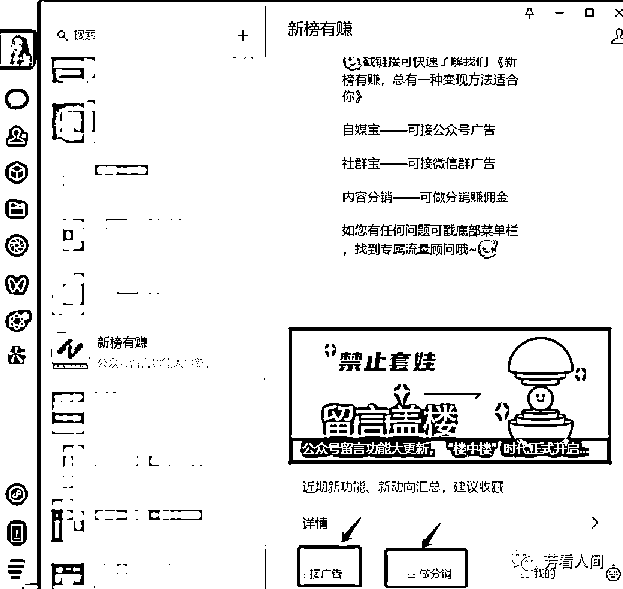
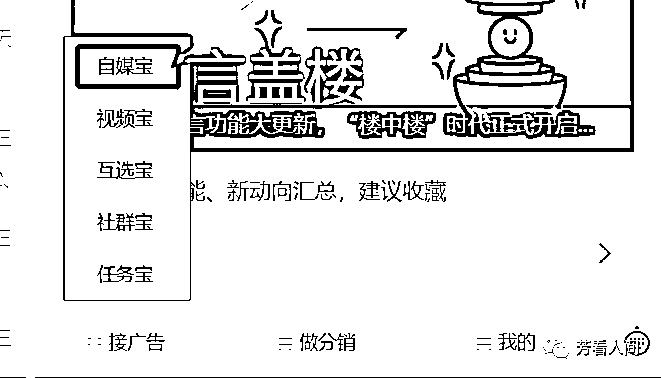
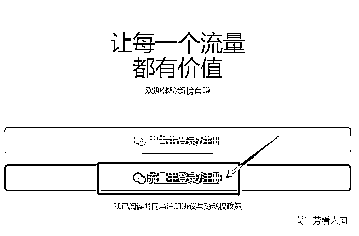
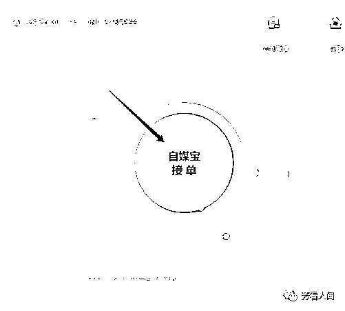
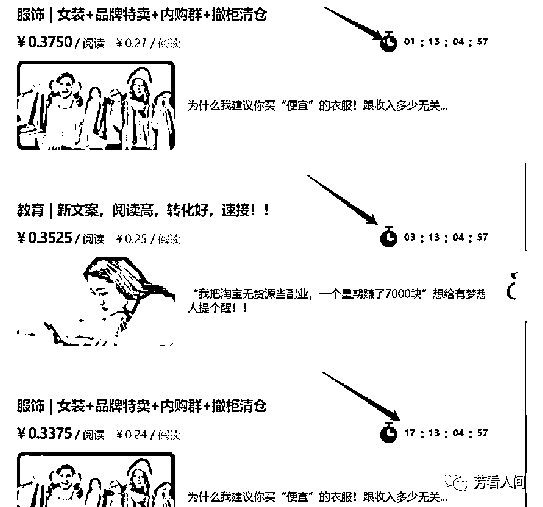
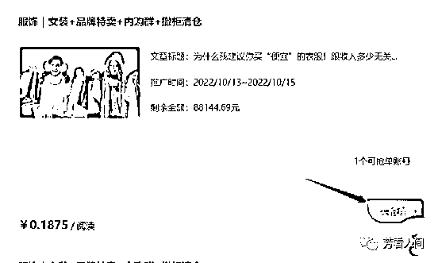
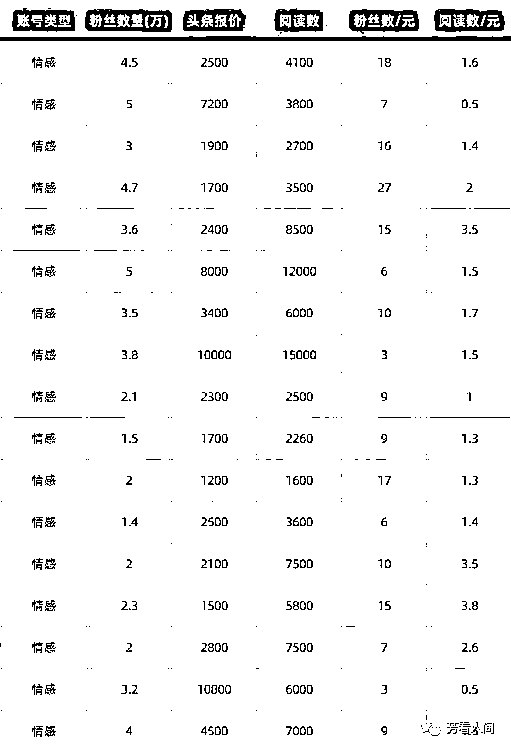
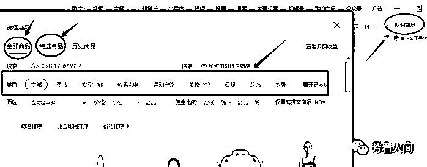
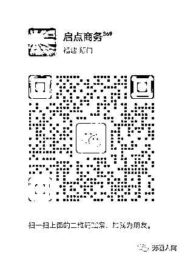

# 6.3.1 广告盈利：公号的主要收入渠道

靠广告来赚钱，说白了就是在内容里植入推广入口。像小程序、游戏、电商那种卡片，有人点一下，或者点了之后消费，号主就能拿到相应的报酬。也有一种情况，整篇内容就是给金主写的定制软文。

目前主流的玩法有四个方向。

方法一：自己找单子

先关注新榜旗下的“有赚”账号。那里面提供了各种赚钱路子，既有分佣推广，也有代发文案。代发文案通常按阅读量付钱，一个点击大概四毛钱；有的要求24小时内删除，有的可以长期保留。平台自带操作说明，想研究的可以自行摸索。

照着系统提示按步骤操作即可。成功接单后，在规定时限内把商家提供的文案贴到自己的公号里，然后坐等收钱。钱到账后能马上转进微信钱包，速度很快，几乎瞬间到账。作者当时接过两次单，都是24小时后删除的类型，每单赚了800多。后来觉得这种玩法容易掉粉，就暂时不发了，等关注人数再涨一些再考虑。

新榜的有赚频道里赚钱路子还有不少，我只试过按浏览量代发文案这一种，其他模式没体验过，其他的就靠各位自行研究了。

方法二：广告主主动找上门

广告主会在后台发来合作私信，然后添加联系方式聊价格。通常需要我们先报价，文案由对方提供，我们直接照搬发布。费用按位置分为首条、次条、第三条，首条最贵，一般2000元起步。不过接这类广告要谨慎，先看看对方的文案涉及什么领域，如果内容涉赌、涉黄或搞迷信活动，千万别接，有封号风险。

价格参考下表：

具体金额和细节，以与广告主最终协商为准。

方法三：在内容里卖货（分享人：徐胖）

靠公号卖货，早些年是个非常火的生意。不过这几年短视频电商兴起，纯文字推广的效率确实在下滑。但要说这行已经没机会，倒也未必，公号电商依然有做头。理由有四个。

其一，公号从来不缺流量。某圈友的写作训练营已经办了七期，累计出过1000多篇10万+爆款，浏览破万的就更多了。一个号日更8篇，每篇最多能挂10件产品，8篇就是80个位置。只要有某件商品成了爆款，收入就相当好看。

其二，公号内容创作很灵活，内容与货品之间的关联度要求不高。就算你写的是情感主题的内容，也能推荐学习、励志、文学、心理方面的书；生活里吃喝用度的东西，同样可以通过公号来卖。

其三，分成空间大。选什么货、拿多少提成，由自己直接去洽谈。书籍的返点最高能到50%，水果、蜂蜜这类产品，提成也在20%以上。

其四，资金安全有保障。整个流程走的是平台官方通道，分账靠谱，到账也快。读者付款、买家确认、收入到账、后台明细、平台打款，每一步都能在管理界面看得很清楚。

实际走一遍也不难：先注册一个公号并完成入驻；等关注人数到500以上，提交收款资料，然后开通广告分成功能。审核一般三到五天，资料没问题的话，当天就能通过。

拿到分成资格后，再去开通带返利的商品推广，在内容里插入这类广告，发布即可，剩下的就是靠分享赚提成。

公号卖货与头条那边的玩法类似：只要内容里提到产品的相关词汇，就能自动匹配可插入的商品。

每篇内容最多放10件商品，读者读到的时候点一下商品卡片，就能直接完成下单购买。一旦成交，号主就能拿到销售分成。

另外，无论卖书、卖生活用品还是卖水果，都可以套用一个固定框架：开头先讲个小故事；接着把话题转到产品上；然后详细介绍商品；最后推动读者下单。想学习具体写法，可以看3月6日分享的《公号卖货诀窍》，分享人是@徐胖。

方法四：在文章尾部挂链接卖货

先扫一扫文末的识别码，注册成有赞平台的推广员；挑好想卖的货，生成一个专属链接，把这个链接放在文章末尾就行。

要是搞不定链接，可以请客服帮忙，不过得把账号密码交给对方。作者当时就是请客服代做的链接。

微信：扫下面的码加好友

最后提醒一句：在公号还没站稳脚跟之前，发内容尽量简洁，别搞得花里胡哨。等号有了起色，再根据读者年龄结构调整风格——年轻读者居多可以做得更有视觉冲击力，读者偏成熟就继续走克制路线。具体来说，正文最上方放张头图就行，不配图也行；文字中间穿插一些分割线。

这些分割线别用得过于密集，差不多每200~300字的间距处出现一次就好，太密或太疏都会影响阅读体验。