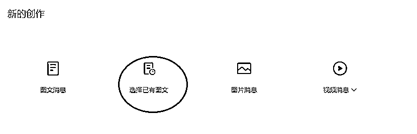

# 7.3.2 旧文别反复推

先提醒一句：以前的内容，能不重复发就别重复发。真要发，也只能挑一两个月前的文章，而且别把它当成日常操作。

现实里大致见过三种情形：

第一种，账号长期把旧内容反复往外推，结果流量被压，状态甚至不如刚起步的时候，一天进账只有个位数。

第二种，有人因为推送旧文，原创标识被暂停了1至3天。

第三种，也有账号每天照发旧文：一天推七八条，其中一条是早先的文章，整体数量看下来没出岔子。

但各账号底子不同，上面这些例子只当参考，不能直接照搬。