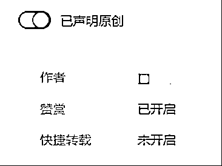

# 7.3.3 发文勾原创，转载权限要关严

发文时原创标识必须勾上，这直接关系到推荐效果和收益单价。想解锁赞赏功能，也得先发满 3 篇原创文章。至于快捷转载权限，务必要守住，不能打开；一旦放开，别人就能随意转载，你的流量也会被分走。

正式发布前，把上面这些选项逐项核对一遍，再确认正文里有没有被插入广告。页面出现对应提示文字，就说明设置没问题。

推文发出后，最好用自己的🛰️打开通读，检查错别字。👸号文章只允许修改 20 个字符，而且仅有一次机会，标题不能改。你可以给自己点赞、点在看，但不要点广告，也别转发到朋友圈和群，更不要请别人代点广告。如果总是同一批用户给你点赞、点广告，账号容易出问题，甚至根本进不了流量池。

内容来源：3 月 13 日《避开这些坑，你也能写出爆款文章》@Nicole·纯

