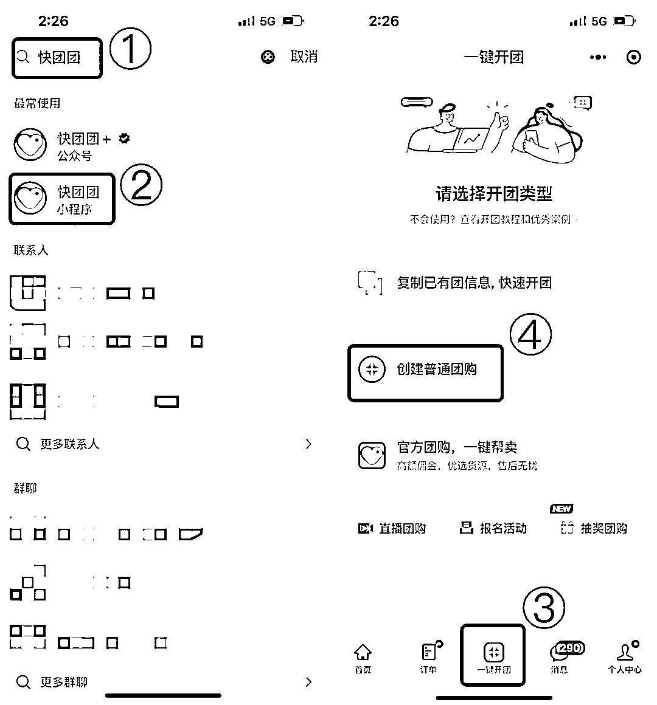
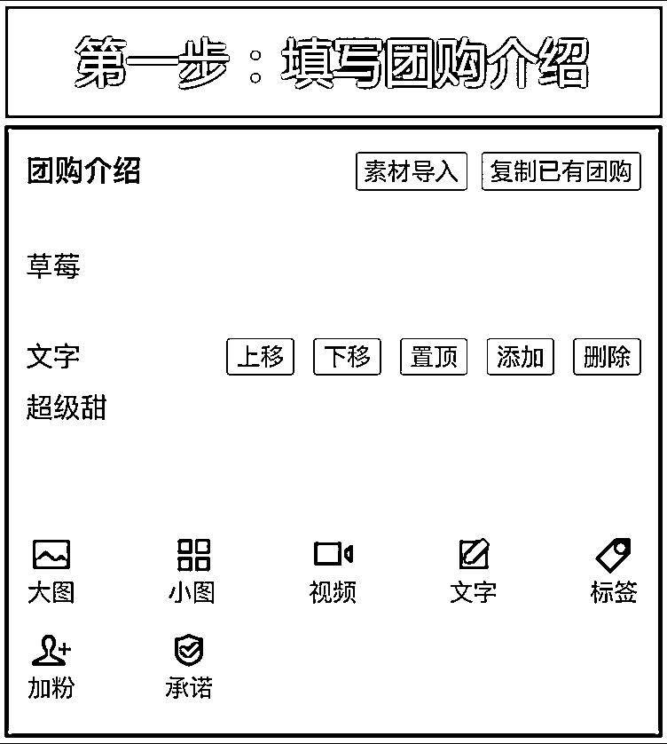
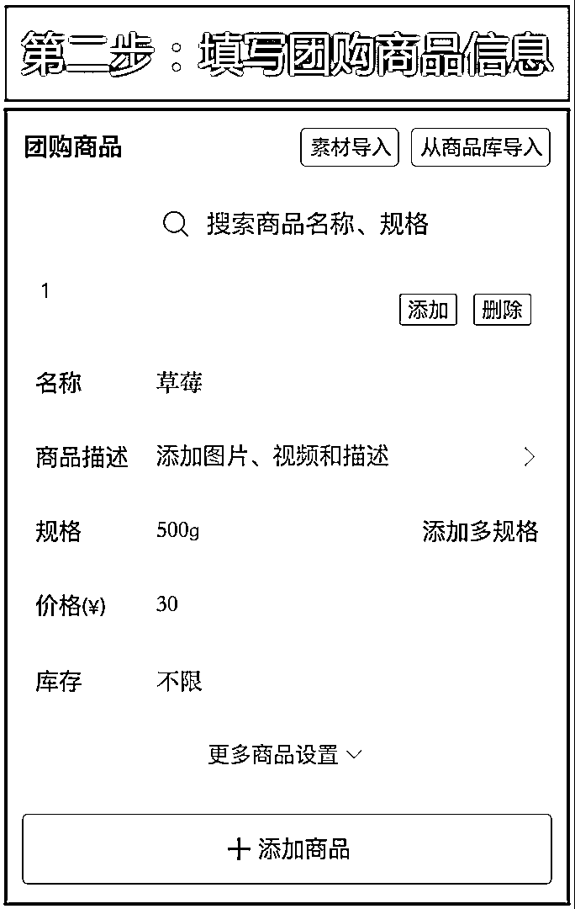
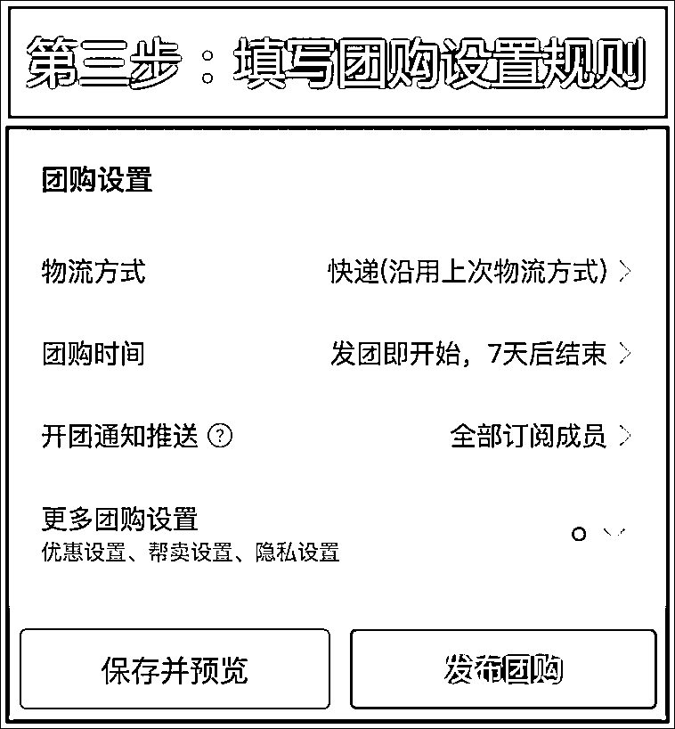

# 第一步：开团卖货，两步搞定

团长可以在快团团上发起团购，把自己的商品卖出去。配送方式有两种：自提和快递。想服务小区及周边住户，选自提更合适，能做落地配；想让更多顾客下单，选快递，覆盖范围更广。

具体开团这样操作：

1）打开快团团小程序，依次点【一键开团】和【创建普通团购】：

2）接着按顺序填好【团购介绍】、【团购商品】、【团购设置】，最后点“发布团购”：

视频演示：[`mp.weixin.qq.com/s/fgcKbswY8JyDp_qISAtMxQ`](https://mp.weixin.qq.com/s/fgcKbswY8JyDp_qISAtMxQ)

