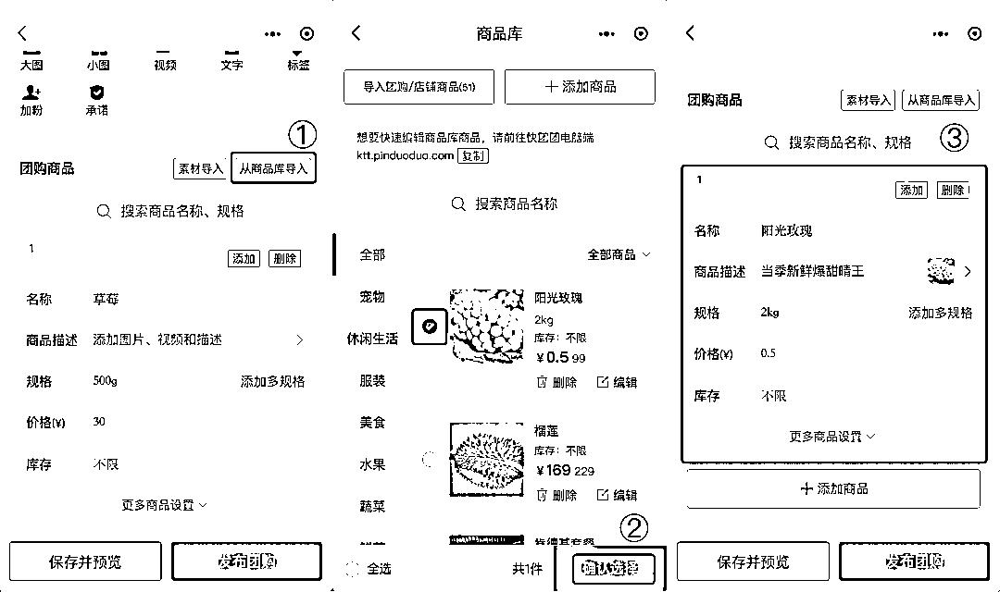
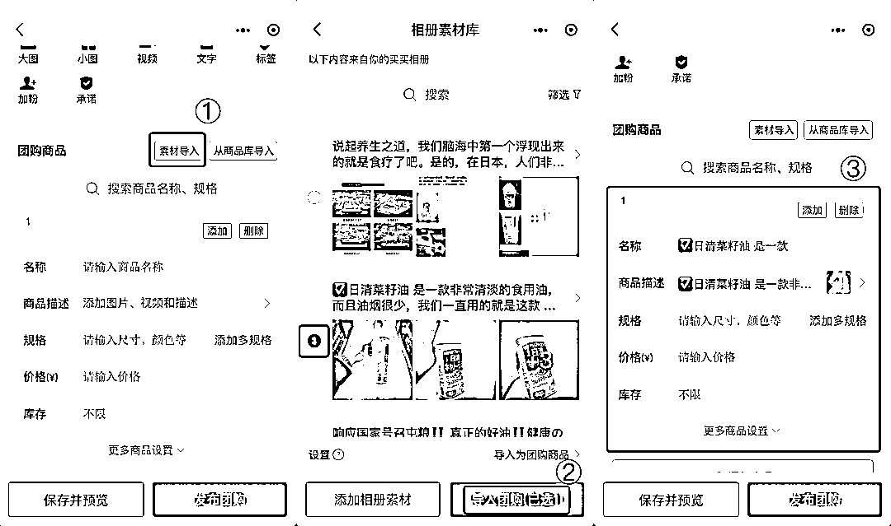
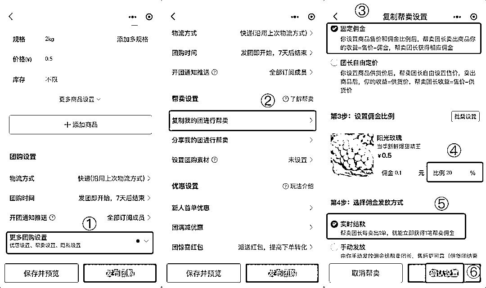
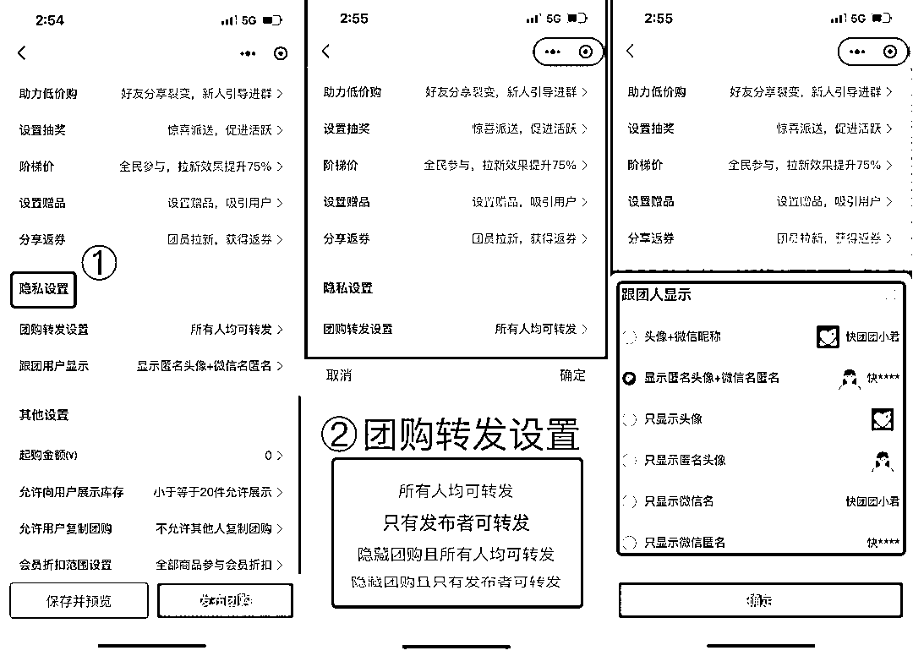

# 大团长开团，关键操作别漏！

大团长开团时，下面几项操作建议逐一确认：

1）商品库里的商品可以直接选入团购：

2）买买相册中的素材也能用来添加商品：

3）依次进入【团购设置】→【更多团购设置】→【帮卖设置】，即可完成【设置团长帮卖】：

4）在【团购设置】→【更多团购设置】→【隐私设置】里，可以管理团购展示与转发权限，以及跟团用户信息的显示范围：

以上设置确认好，开团更省心。