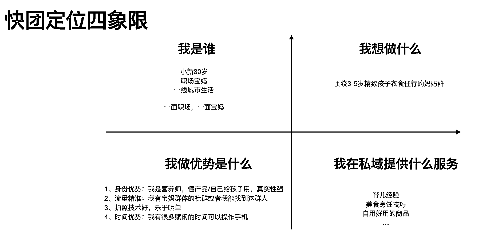

# 先想明白：你的快团团到底要卖给谁？

做快团团，流量决定你的定位，而定位又直接影响后续的选品和社群运营。所以别急着开干，先想清楚一个问题：你到底要服务哪群人？

## 1\. 怎么找定位

快团团的核心逻辑，是私域里的反复购买。

- 有些东西用户会反复买，比如水果、生鲜、肉类；
- 有些东西是品质刚需，比如尿不湿、绘本、厨房湿巾；
- 还有一些东西是用来提升生活幸福感的，比如鲜花、好看的餐具、精致的厨具。

但注意，所有这些都取决于你手里已有的用户需要什么，以及你未来想吸引什么样的用户。

记住一条原则：越垂直越好，越精准越好。前期可能赚得不多，但时间久了，你的价值会越来越高。举个简单的例子，如果你专门服务3-5岁孩子的妈妈，只卖她们刚需的东西，那她们有需要时第一个想到的就是你。反过来，如果你做的是水果群，大家想吃水果时自然也会来找你。

下面这个四象限可以用来测试你的定位，值得好好琢磨：

## 2\. 把基础配置弄好

定位想清楚之后，就要把头像、昵称、简介、背景图这些基础项都补上。

假如你是一位宝妈，想做母婴类社群：

- 【昵称】可以叫「安妮妈妈」
- 【简介】要写清楚“我是谁”和“我为什么做这个号”。把自己的基本信息提炼出来，包括昵称、性别、年龄、生活状态、价值观等，写得越具体越好，内容越丰富，看起来越真实。（注意：人设不等于本人）
- 【头像】可以用自己抱着孩子的照片，或者用在线设计工具做一个也行。