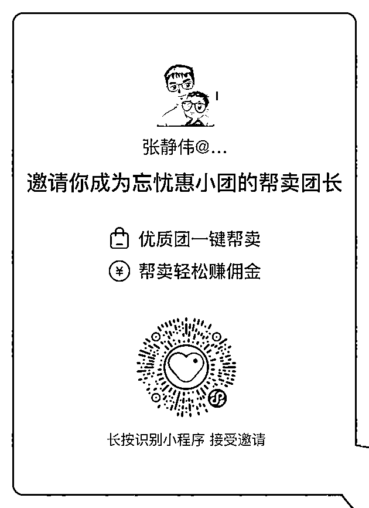

# 2）忘忧惠团：快团团供应链实力派

忘忧惠团于2019年6月成立，总部设在青岛，以分布式办公方式运营，营销商务部门分布在北京、杭州、新疆、广州。2020年起，团队进入快团团供应链领域，代理品牌中包括联合利华等多家商家；同时与蜜瓜、云爸、猫家等私域头部及中部大团长迅速建立商品合作，并达成销售目标。其社群团购年销售GMV已突破亿元。

2022年12月，忘忧惠团采用孵化与定向邀请结合的方式，开设快团团大团长账号“忘忧惠小团”，覆盖食品、母婴、百货、宠物、护肤五个品类，以品牌直签、官仓发货、售后兜底为核心。主理人已连续三期出任龙哥盟快团团航海教练，为赚钱圈友的商品提供保障。

识别下方小程序二维码，即可成为忘忧惠团的帮卖团长。

