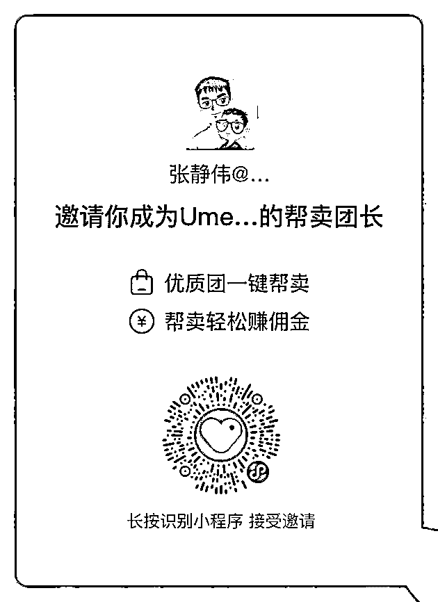

# 6）易开团：团长选品好帮手

2022年10月，苏宁易购推出了官方项目——易开团。它把服务对象锁定在头部带货团购主理人，提供专业化的货品组织与供应支持。合作方如今约五十位，柯柯、三妈团、小马优选以及欣欣优选、苏苏高品质、阿迷高品质等伙伴都在其中；每月联合推广的单品超过一百款，还跑出多款销量破万的爆品。

该平台还开设了Ume 福利社，专门为帮卖型团长提供货盘。这里的商品从大型团购主理人卖得好的单品里筛选，覆盖生鲜食品、居家日用品、小型家电等多个方向；价格尽量压低，佣金尽量给高，配套服务也力求到位。

扫一扫文末入团码，即可开通帮卖身份，跟着一起开团。

