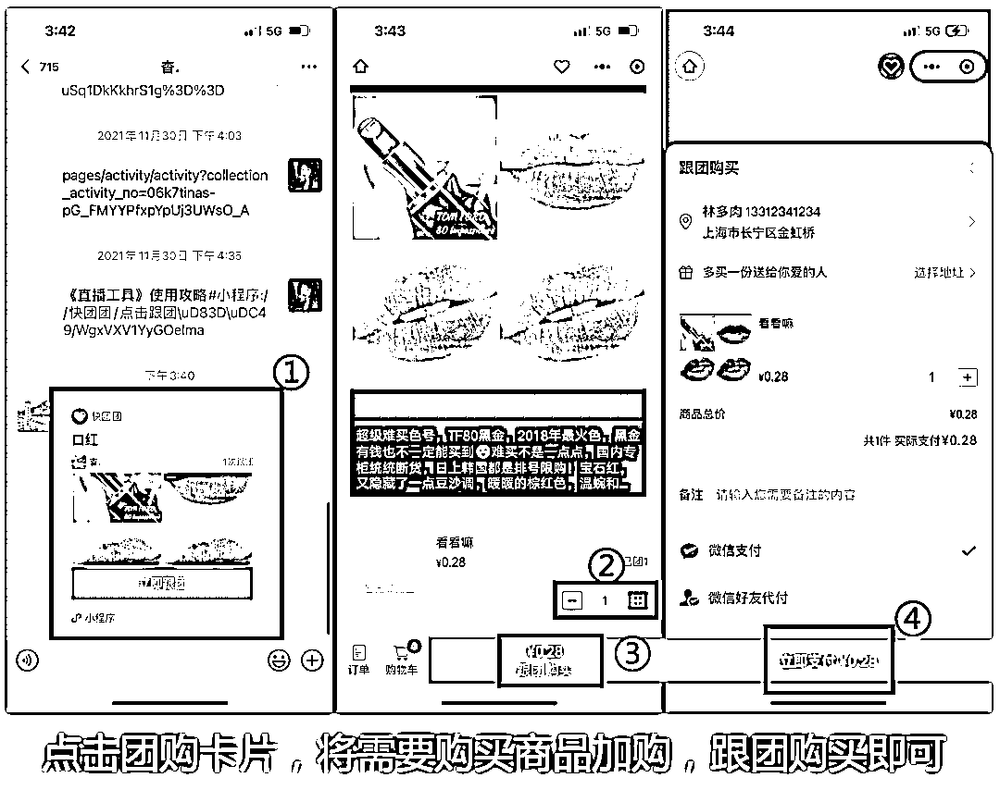
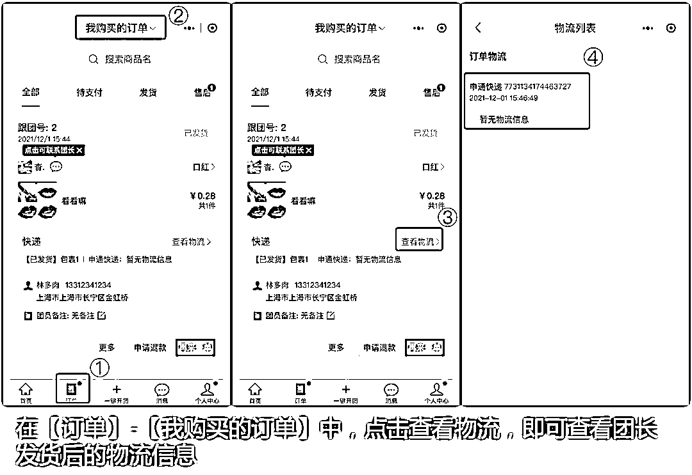
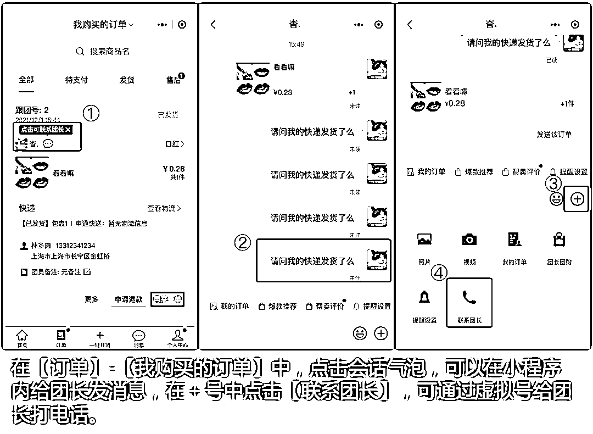

# 第四步：成交后，订单与物流这样查

把「帮卖团购卡片」发给顾客，订单就会随之产生。下面把成交之后的完整流程拆开讲清楚。

先划重点：这里说的「帮卖团购卡片」，必须是你完成上一步帮卖动作后，分享出去属于自己的那张团购卡。千万别顺手把供货大团长的帮卖链接丢进群里——那样成交的订单跟你没关系，佣金也就拿不到。

1）顾客下单怎么操作：

2）顾客怎样查自己的订单和物流进度：

3）顾客如何找到团长

通常顾客付完款后，会主动联系或添加团长。在快团团小程序里，按下面这条路径就能实现：

注：顾客从哪张团购卡片下单，联系到的就是哪位团长。举个例子，顾客通过你（帮卖团长）的卡片完成购买，对接人自然是你；如果你这边解决不了，再由你去找供货团长沟通。

走到这一步，顾客完成下单，帮卖团长的售出任务就算完成了，后续发货等事宜由大团长负责。

