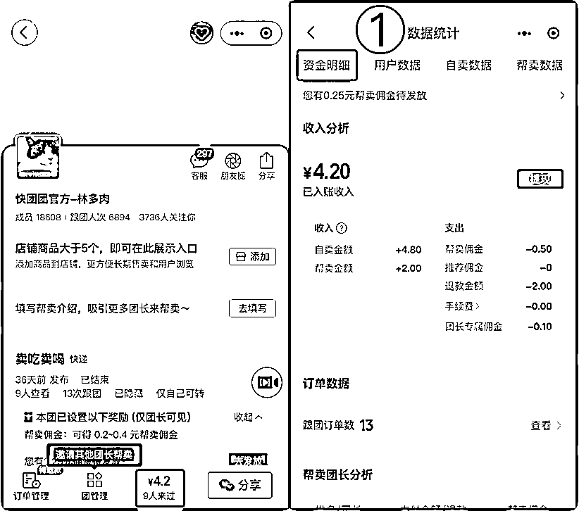
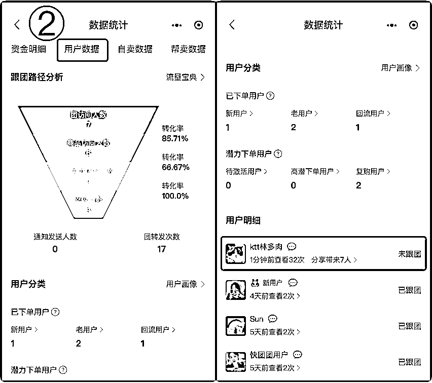
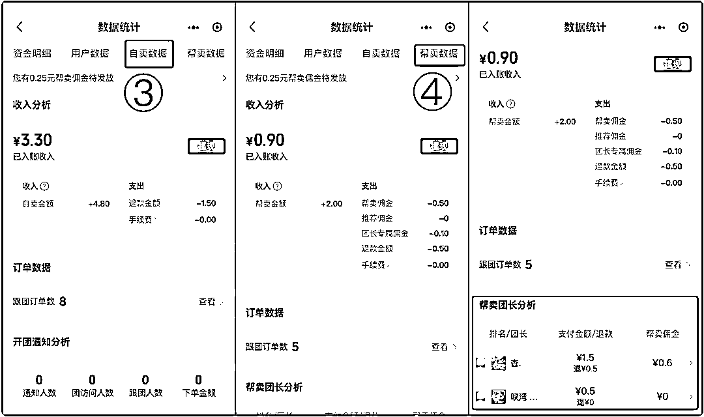
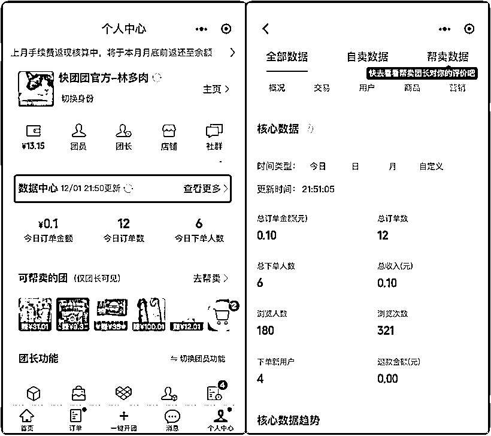
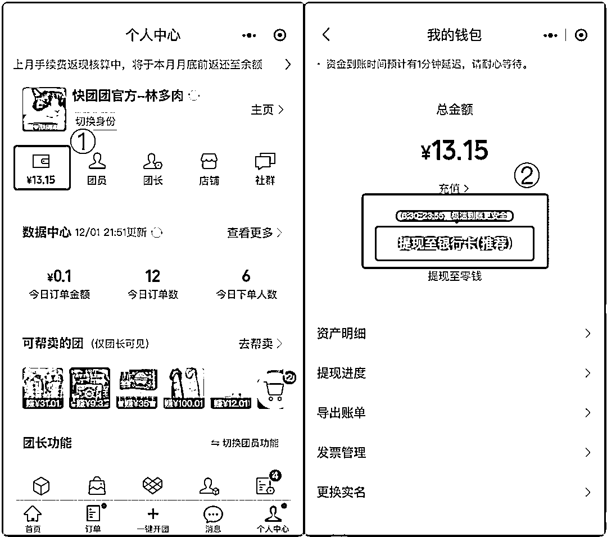
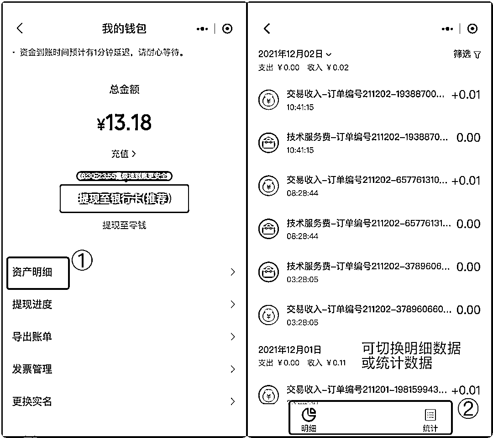
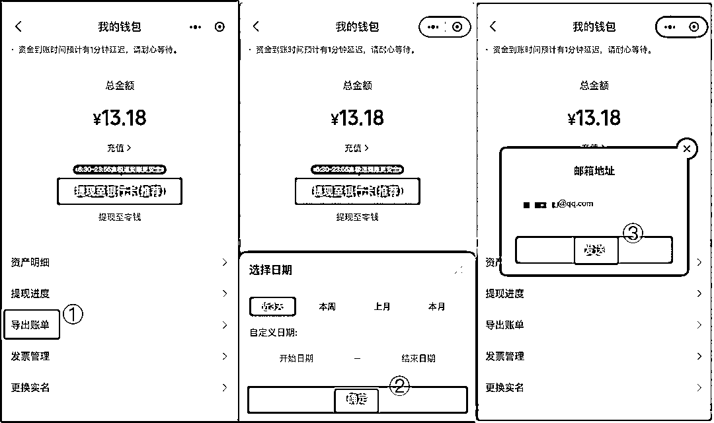

# 第五步：团长收益查询与提现指南（帮卖型、供货型团长通用）

1）单场团购收入查询：

打开某场团的详情画面，在左下方找到金额入口并点开，即可跳转到资金记录页。该场团的以下信息都能逐项核对——

•收支流水

•团员行为与画像：团员打开次数、经转发链接进入的访客量、是否首次参与、有没有下单跟团

•自主销售表现

•帮卖贡献：能看到帮卖伙伴按业绩排序的榜单

2）全量经营数据掌握：

在『我的』页打开数据统计模块，可按日期、品类等条件筛选，整体经营情况一目了然。

3）余额提现操作：

从『我的』页进入钱包入口，即可把余额转出。若供货型团长没有另行设置，佣金会按默认规则自动结算——买家付款成功后，款项会直接进入你的平台账户。提现可转到🛰️余额或储蓄卡，平台免收手续费。

提现时间与额度：

•🛰️余额：单日上限 3000 元，款项即时入账；

•储蓄卡：单日上限 5 万元；每日 9:00-23:00 提交且金额在 5 万元以内可即时入账，其余时段次日（T+1）到账。

4）资产明细核对：

从『我的』页进入钱包，点开资产记录。每一笔收支都能查到；切到统计视图，还能按天或按月汇总进账与出账。

5）账单导出：

从『我的』页进入钱包，找到账单导出入口，设定好时间区间，账单就会发送到你的电子邮箱。提交后约 10 分钟，邮箱里就能收到这份文件。

