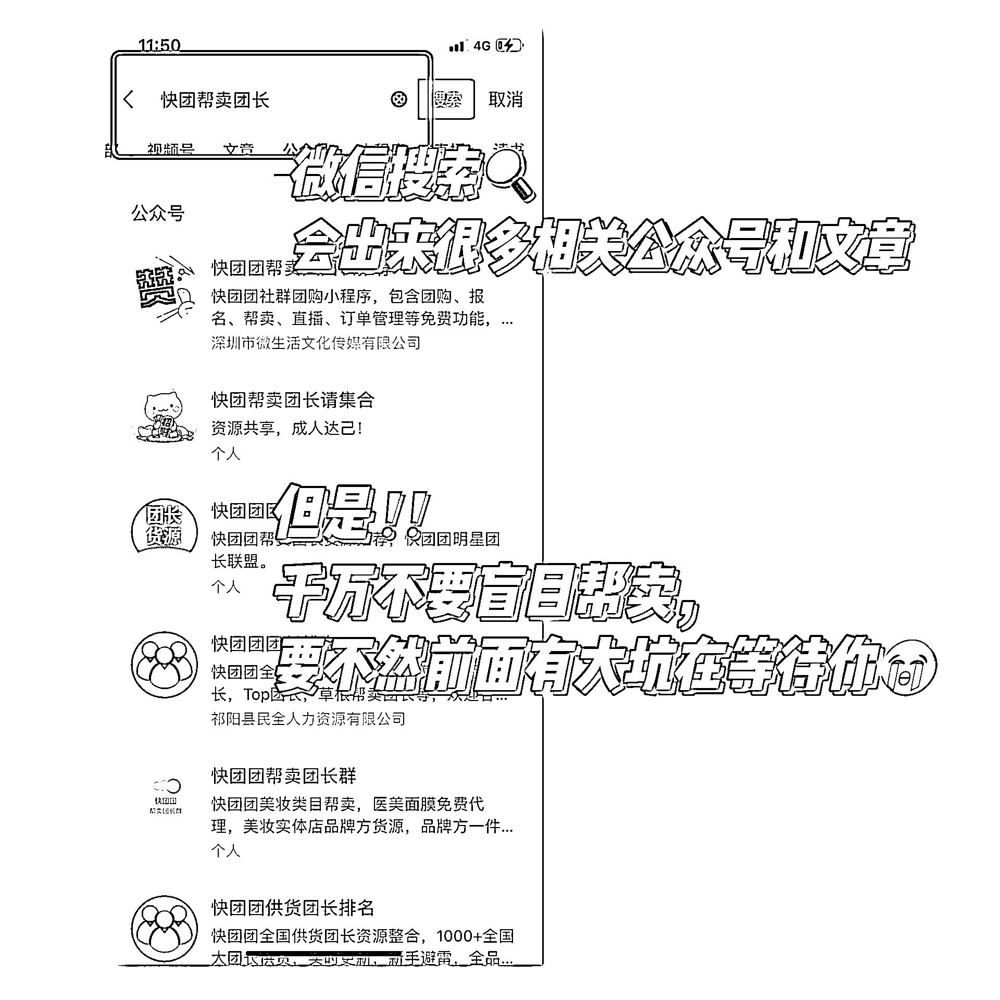
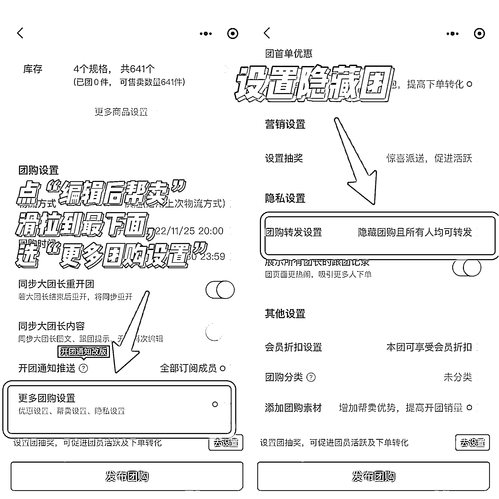
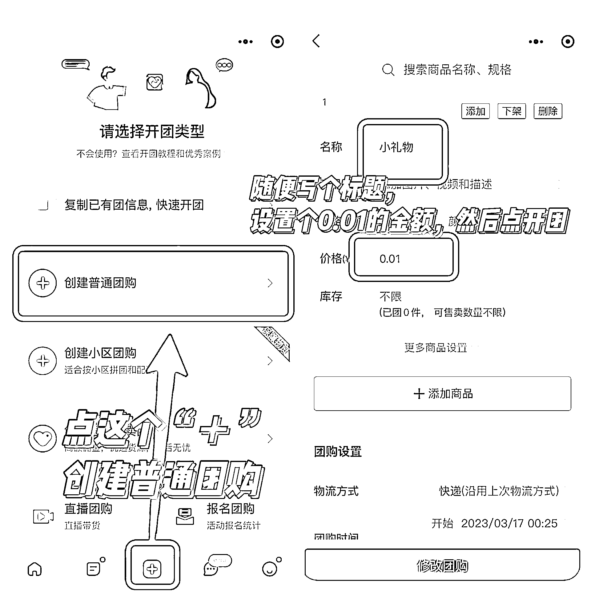

# 2.3 供货团长怎么挑？先学会避坑 @宝藏小鹿 @星宇

想把货盘做得更丰富，完全可以自己去对接供货团长。但这一步不能图快，得把对方的情况摸清楚，否则很容易踩坑。圈友@宝藏小鹿整理了一套找团长、辨团长的方法，下面直接上干货。

1）找团长的入口有哪些？

渠道其实不少：可以在微信里搜“快团帮卖团长”；也可以在闲鱼、小红书、微信、抖音搜“快团团”“快团团大团长”等关键词；还有不少公众号和文章会推荐团长。说到底，团长不难找，难的是找到真正靠谱的那个。别一上来就盲目帮卖，筛选比寻找更重要。

2）怎样判断供货团长靠不靠谱？

有人会看团员数量、团品销量，或者团品在快团团的级别排名。这些指标有一定参考性，但太“摆在明面上”，不排除有假数据的可能。尤其要记住：团员人数多，并不意味着售后风险低，两者并不成正比。

那关键要看什么、又该怎么看？先看商品。

品牌商品有市场价格作参照。比如苹果手机市场价8000元，快团团里卖7500元，算合理；卖5000元就要多问一句：为什么能便宜这么多？背后会不会有坑？要是只卖3000元，别犹豫，赶紧撤。

非品牌商品的价格更难判断，只能给个区间作参考。比如苹果，水果店3斤卖30元，快团团卖20元可以理解；若3斤只卖9.9元，已经击穿正常价格带，收到问题货的概率就会明显变大。

判断售后，可以分场景做压力测试。

场景A：先加大团长的售后客服微信，挑一单你打算带的商品下单，趁还没发货立刻申请退货。这里要留神，有些商品会被设置成不支持退货。这样做主要看两点：售后响应快不快，退款顺不顺。

场景B：同样先加售后客服微信，下单你想带的商品，等发货并签收后再申请退货。同样要防着“禁止退货”的坑。这一步除了看响应速度和退款效率，还能顺带感受货品品质，看看有没有超出预期的体验。

小提示：自购测试时，把团品设成「隐藏团」，先别对外展示。

进阶玩法：比价和佣金关系。等你带出去的货越来越多，就可以比较不同团长在同一货源上的佣金比例，这个不展开，懂的人自然懂。

特别提醒：快团上的化妆品别轻易帮卖，假货风险高。哪怕这个团长的服装鞋帽很稳，也不代表化妆品来自正规靠谱渠道，务必慎之又慎。

3）团员数和跟团人次怎么往上提？

现在快团发展起来后，不少供货团长为了避开全民帮卖，把门槛越设越高，新团长起步更难。很多人做了一阵子，想申请更多团长，却卡在团员数和跟团人次不够。可以用两步做数据优化：

a. 闲鱼上有人提供刷团员数服务，先少量刷一点，试试对方靠不靠谱；

b. 刷跟团人次，自己随便开一个0.01元的链接，然后自己和朋友反复下单，一周内陆续买满1000单。

当团员达到1000、跟团人次也达到1000，能申请的团长就多起来了。

内容来源：《新手团长快速“脱白”的几个步骤》

