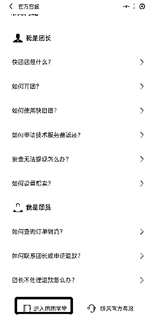
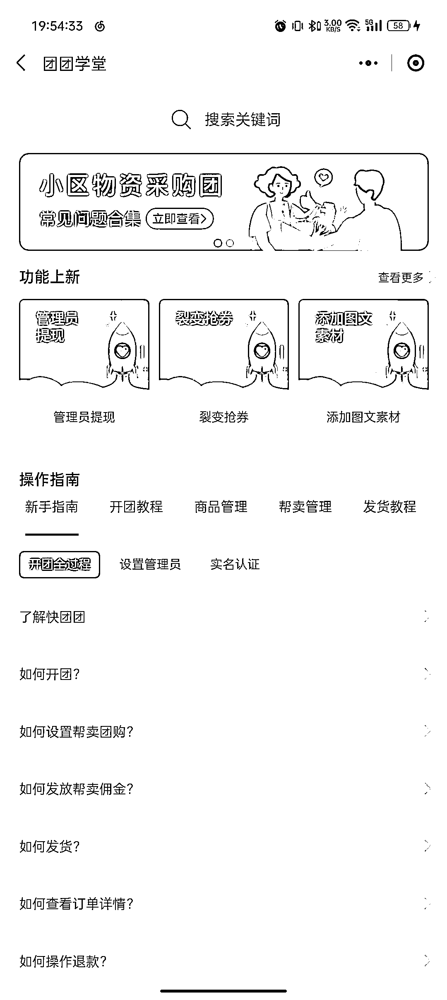
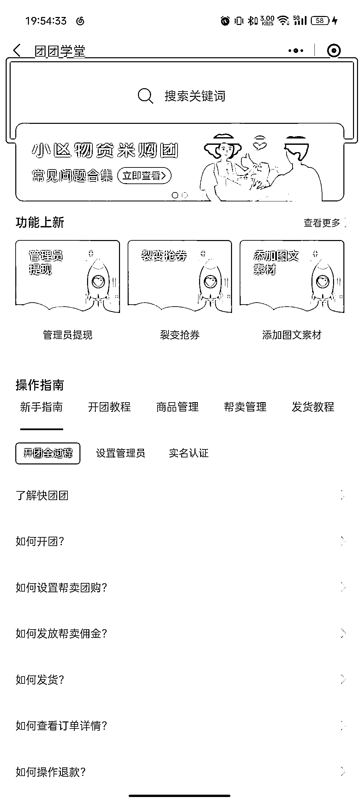

# 2.4 快团团还有哪些实用功能？

前面已经聊过用快团团完成开团和帮卖的基础步骤，但真正上手后，大家常会碰到更具体、更个性化的问题，因此我们又梳理了官网常见问答，整理成一个问答库。你可以结合自己的情况，点开对应问题，查看教程或答案→点这里跳转（文末附录：快团团高频问答库）。

想获取更多解答，也可以在手机端打开快团团小程序，进入“团团学堂”查看。要提醒的是，团团学堂里有些内容可能已经过时；如果仍然没能解决你的问题，可以在航海群中 #举手求助（本次航行期间）。

操作路径：快团团小程序-个人中心-官方客服-团团学堂

如果你有明确想了解的问题，也可以直接搜索关键词来查找答案：

