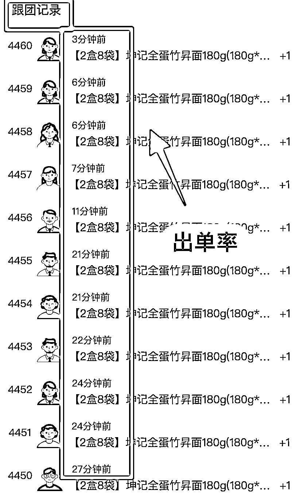

# 3.8 方法八：选品推品，先看人群再用数据 @小白

做选品和推品，别一上来就凭感觉。先把人群拆清楚，我们最常看的三项是：性别、年龄段、核心需求。

举个例子，假如目标用户是女性，主要落在30～50岁，身份是妈妈、奶奶或外婆，而且很在意孩子的学习，那选品就可以围绕这个年龄段女性的教育需求来做，同时覆盖她们经营家庭、打扮自己等生活场景。

人群有了轮廓，再让三组数据帮忙判断：

• 转化率：结合查看数和订单数来看
• 出单率：按最近订单时间排序来观察
• 开团时间

真正开团时，这三项要重点留意。一般只要其中两项符合要求，就可以考虑开团。

内容来源：《如何用数据来支撑选品和推品，提升用户体验和粘性？》

