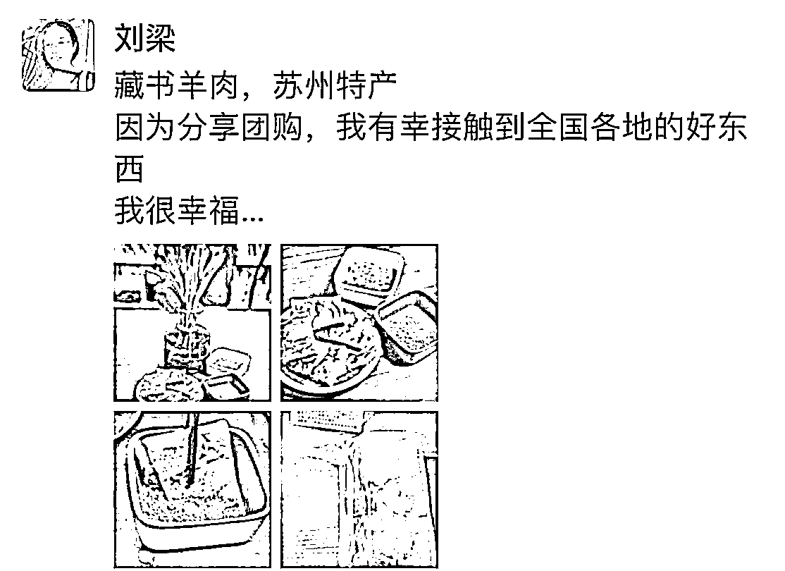

# 4.1 朋友圈加社群矩阵：冷启动靠信任跑通 @刘梁

方法一的关键，是把私域裂变和朋友圈经营结合起来，先搭起一个信任感强的社群，让冷启动顺利起步。

1. 群友从哪里来？
1）最早是熟人圈，亲戚朋友先加入。
2）我在朋友圈晒美食、好物，有人下单后，我会主动问一句：要不要进群？
3）群友也会把亲友带进来，这一步裂变很关键，因为被拉进来的人往往很精准。

2. 朋友圈怎么经营？
1）每天早晨，我会在朋友圈发诗和歌。
2）团到好东西，也带着开心、享受的心情分享出去。
3）生活里的真实片段也会发，偶尔还吐吐槽，让大家看到我鲜活、有趣、有温度的一面。
4）鲜花、健身、旅行这些能提供情绪价值的内容也会出现，让人感受到我积极、热爱生活。

3. 怎样让群友信任、认可？
1）坦诚是底色。做得好的地方分享，不够好的地方也如实说。
2）品质是地基。选品和供应链必须严把关，因为团品一旦离开品质，就会变成灾难；不好的东西在群里传得很快，名声很快就会坏掉。
3）责任心是护栏。万一选品踩坑，要积极处理：该售后就售后，该补偿就补偿。比如有些衣服供应链不给退换，我就让群友寄给我，自己穿或送朋友。不能只盯着赚钱，也要留出一部分做保障，让群友知道：在我这儿买到不合适的东西，也有人兜底。

4. 搭社群矩阵，扩大社会连接面
除了好物分享群，还可以做别的群，扩大连接触角。比如我有一个学习分享群、一个断舍离群、一个有机菜群。这些群都能给团购群引流；我在那些群里做的公益付出，也成了好物分享群的背书。团购群里的人连接强，退群的人很少。

内容来源：《一个转化率 40%的乌托邦式的社群团购是如何做到的》

