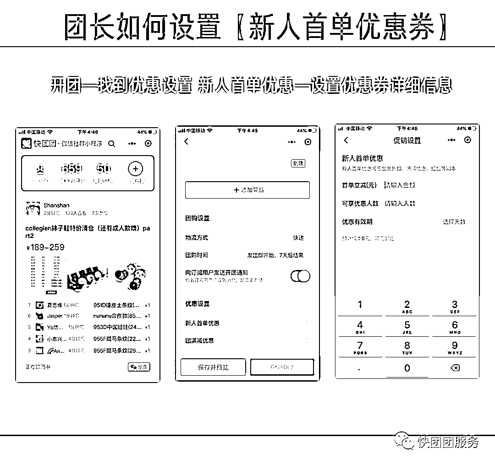
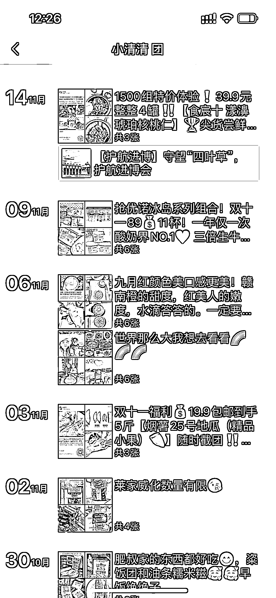
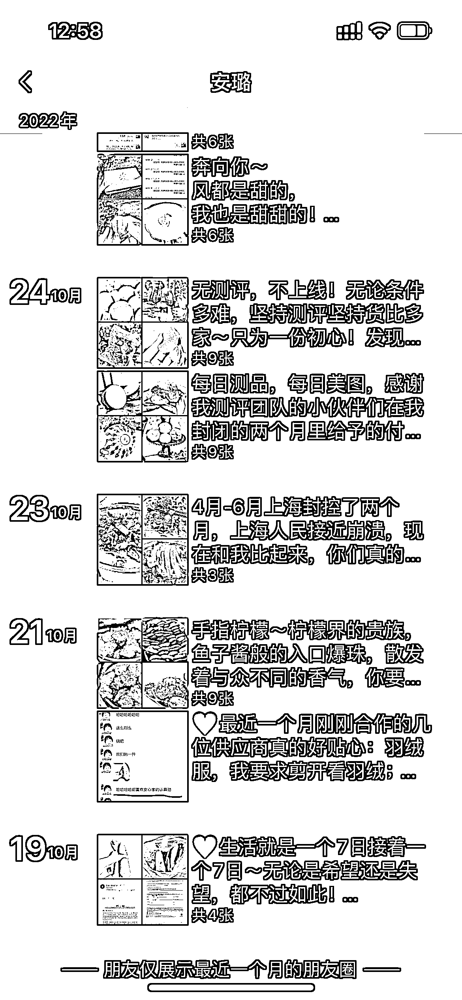

# 4.4 冷启动破冰：埋伏带节奏，人情味促单

做冷启动时，不妨先请几位信得过的朋友提前进入你搭好的社群。社群简介和群规要事先准备好，等你正式邀请新人入群，他们就能及时接话、帮忙暖场。

也可以让这些提前进群的人替你发问：大家最近想要什么产品？再借他们的口，把接下来准备上架的商品自然推出来。不过这一招不能频繁使用，否则容易露馅。更稳妥的方式是穿插真实意见征集，或者向供货大团长了解他们近期收到的需求反馈。

作为帮卖团长，建议每天固定时段在群里发起话题，让社群保持活跃；还可以用红包换真实好评和返图，遇到大单适当给返现奖励。

新建的群通常最有热度，要抓住这个窗口。借助快团团自带的工具设计游戏化玩法，例如设置新人首单优惠，引导顾客先下单，等收货后再收集一波好评，第一轮启动就会轻松不少。

新人首单优惠教程：
#小程序：//快团团/DcrMj1Eikhio31u（复制该小程序文字到🛰️打开）

实操举例：团长欣欣从自媒体吸引了一批新人进入私域社群，但新成员大多持观望态度，入群后便不活跃，订单迟迟不来。她设置并发放了新人首单专属优惠券：首单减2元，限120人，3天有效；同时上架几款低客单价商品，花几元钱就能买到十几元的东西。结果新人们陆续下单，500人的群里产生了109单新人订单，转化很快。部分新人首单后还订阅了欣欣，之后每次开团都能收到通知。

操作路径：创建普通团购→更多团购设置→新人首单优惠

图片教程：

朋友圈一定要发。别因为担心被拉黑就完全抗拒；但频率要拿捏好，低质量内容刷屏会拉低别人对你的期待。也不要只发带货内容，穿插一些生活化分享，会更有真实的人情味，而不是一台没有感情的卖货机器：

