# 4.6 方法六：公域引流+朋友圈玩法 @五加皮

1）公域平台怎么往私域导流

先来解决最核心的疑问：公域流量到底怎么转化为私域好友？实际上，抖音、知乎、快手、🧣、📕这些平台都能用同一套逻辑，因为人的心理是共通的。反过来，你也能用这套方法把朋友圈的用户导入社群。

最常见的5种玩法：

•送优惠券
•抽奖（我最爱用）
•折扣
•送资源/资料
•免费引流品（比如送你100片面膜，或者承包你3个月的纸巾）

来看一个真实案例⬇️

我当时准备了4个奖品钩子：抽奖送英文原版书、送价值129元的泰国Ray面膜、送20元无门槛优惠券，以及英文原版杂志：

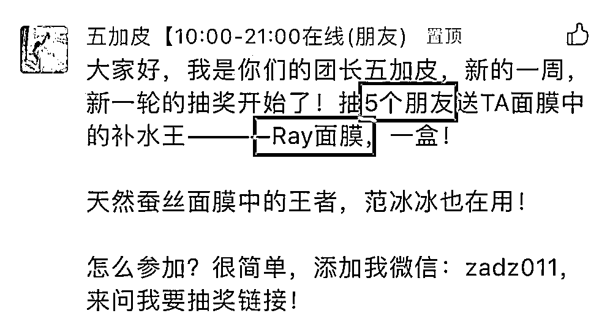

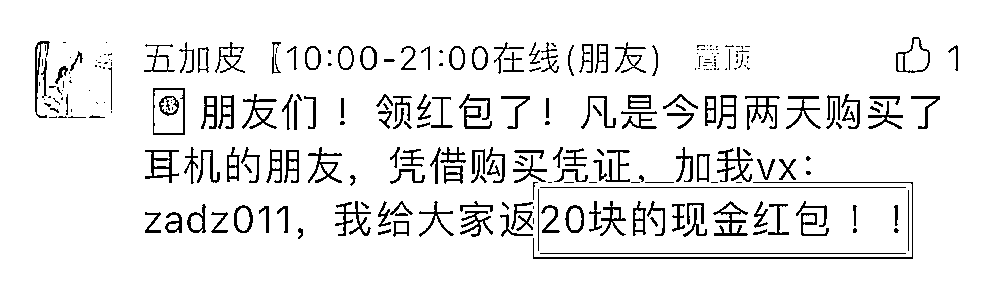

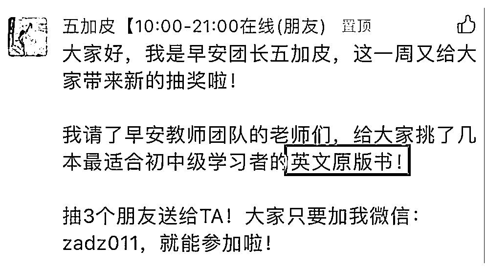

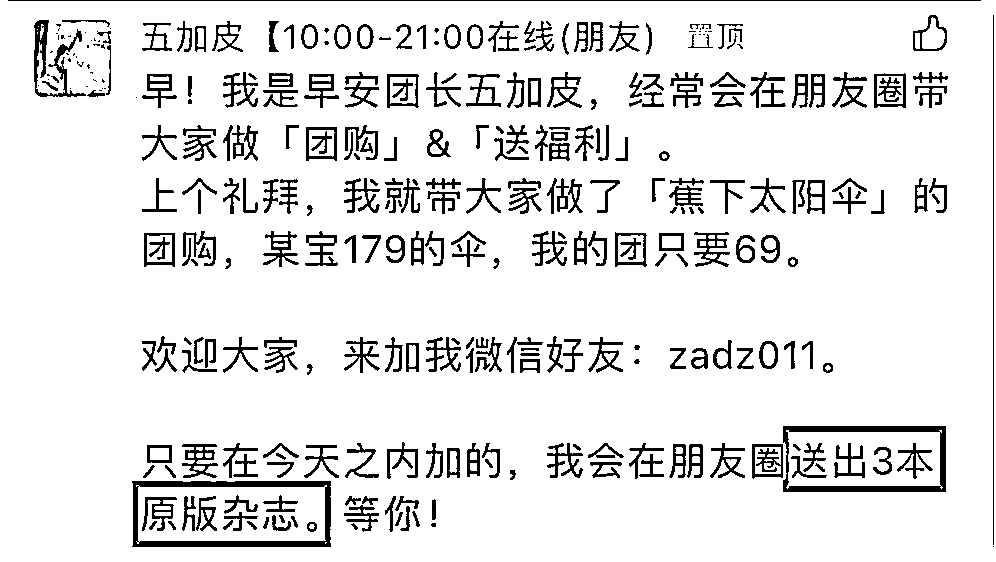

大家猜猜：哪个奖品带来的引流效果最好？

我们用数据验证过：英文原版杂志和英文原版书效果最好，因为吸引来的用户非常精准。

这里我不展开细说，毕竟你最了解自己的用户。但有一点必须强调——抽奖的选品非常关键，它直接决定了导流效果的成败。

我们目前的节奏是：每周开一次抽奖，平均每次能带来300-700个订阅，400-600+个私人🛰️好友。

2）朋友圈到底该怎么发

这个问题也是很多新手最困扰的——朋友圈怎么发才有效？

先来填个空：

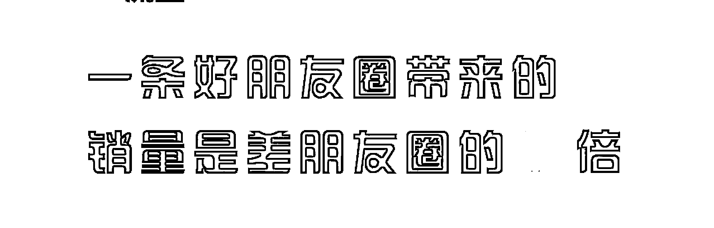

答案就是：10-20倍！

接下来我从文案、配图、发圈时间三个角度来拆解：

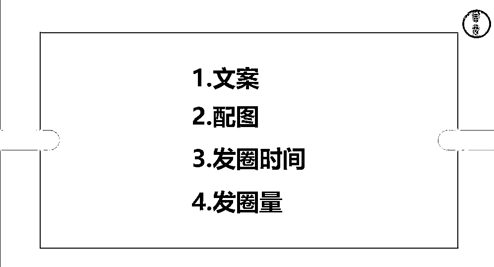

A、文案怎么写

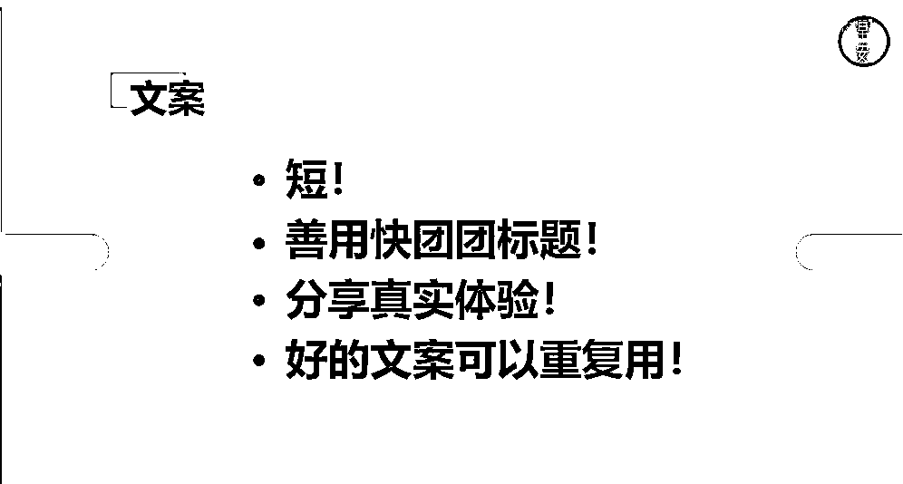

好的文案根本不用太长，控制在4行以内，每行不超过16个字，就不会被折叠。太长没人爱看，但短不是核心，精炼才是。

写不出来怎么办？其实每个人都有体验。比如你到包子店吃了一个包子，它好吃还是难吃，你马上有感觉。把这份真实感受写出来，就是最打动人心的文案。

还是没思路？大团长们通常有专职文案团队，他们的做法是把快团团标题直接拿来改，因为标题已经是对产品特点的最佳概括。抽出重点信息，删掉废话，让文案变得精炼。这个方法我强烈建议大多数人采用，既省时间又确实有效，而且可以批量复制。

另外，好文案是可以反复使用的。我们会不定期做文案复盘，记录哪些文案转化率最高，之后继续复用。

举两个例子。

内裤文案怎么写？

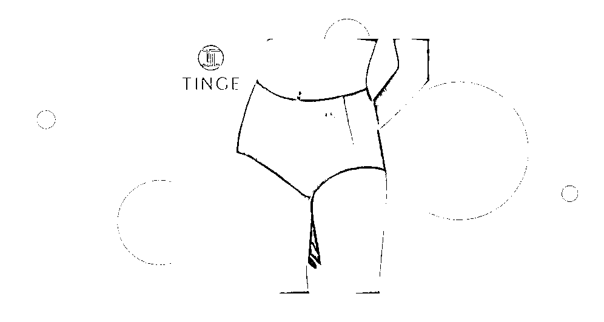

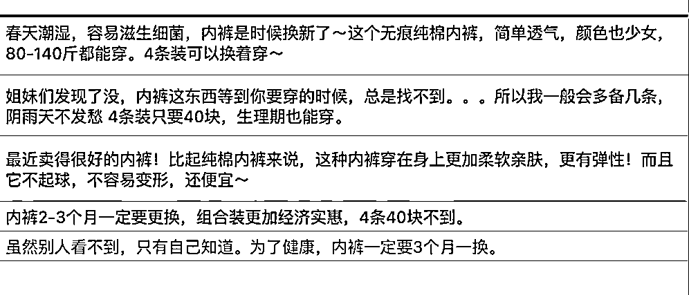

那条标红的内裤朋友圈，我印象特别深。每次发出去，内裤订单至少10+。我会不定期翻出来重发，不需要喊“我的内裤好啊，快来买吧”，只要配上内裤二维码，订单就哗哗地来。

再说防晒衣，夏天的爆款：

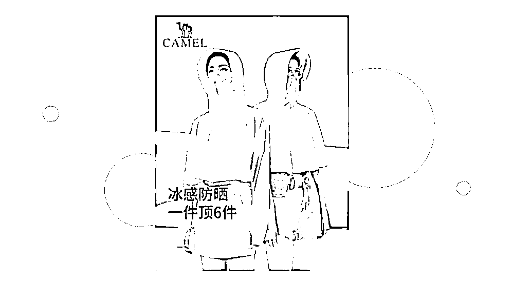

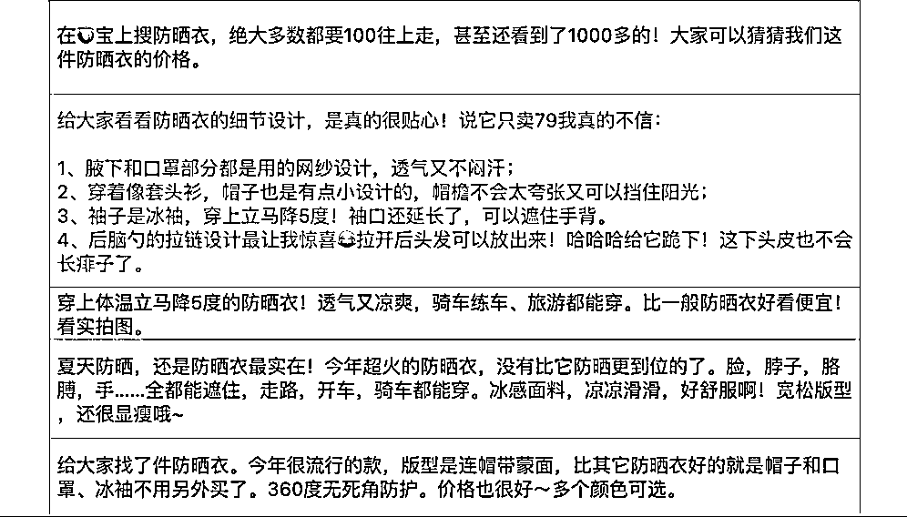

大家可以重点关注标红的那条圈，它是体验型文案的完美示范。虽然字数偏多，但用1234列出来，看起来很有条理；更重要的是，它不是干巴巴的体验，而是带着情绪，比如“我真的不信”“给它跪下！”

B、配图怎么选

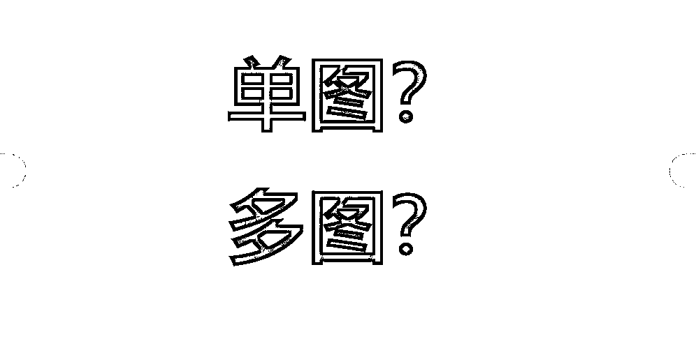

互动：你觉得朋友圈配图多图好还是单图好？为什么？很多人都会选多图，但这事得分情况：

•食品类、服装类、鞋类，强烈建议发多图，而且要用好看的模特图或实拍图，3-4张最佳。
•日用品类、引流款，放单张图就够。比如9.9元一箱的紫米面包，它的优势就是价格，一张图突出价格即可。

这些方法也能批量化操作，复制起来很简单。

C、发圈时间怎么定

大家都知道文案和配图重要，但发圈时间往往被忽略。

互动：你觉得什么时候发圈最好？

这5个黄金时间段一定要抓住：

•8:00-8:30 上班通勤高峰
•11:30-12:30 午休时间
•16:00-16:30 下午肚子饿了，适合发吃的
•17:30-18:00 下班高峰
•20:30-21:30 晚饭后睡前，大家都在刷手机

下午4点和晚上，我们会集中发零食类（不是米面粮油）。淘宝的数据显示，下午4点是逛淘宝的高峰期，而零食又是这个时段搜索量最高的品类。

D、发圈频率怎么掌握

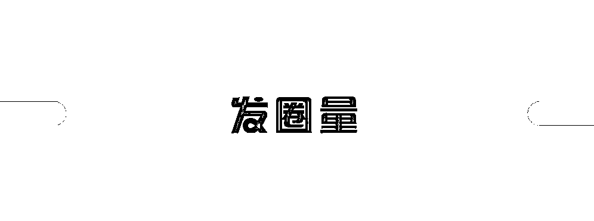

关于发圈量，我们是怎么做的？

从早上8点到晚上23:30，每半小时发3条朋友圈。原则就是：让内容均匀地出现在用户的时间线上，尽可能多做触达。

很多人担心发太多会被删，收到一两条好友删除提醒就开始焦虑，觉得这样不行。但你加他是为了什么？让他给你点赞吗？你是卖货的啊！不在你这里花钱，对你来说就是0价值用户，删了也不可惜。

如果你不确定这样做对不对，跟着我做就对了，肯定有用。一定要多触达用户，他连你的朋友圈都看不到，怎么可能在你这里下单？

总结一下：私域到底怎么运营？翻译过来就是——我每天疯狂发圈，怎么让人不删我？

关键在人设！要利他、要真诚、要能帮对方解决问题。

我的朋友圈人设是：一个喜欢抽奖送礼、带你薅羊毛、专挖性价比好物的90后女生，还经常在朋友圈晒好看的照片、分享有趣生活，长得有点像泰国人。

最后提醒：不管每天发多少条，一定要保证3条纯私人朋友圈！

内容来源：《私域如何转型做快团团？10个月一千万，我做对了这3件事》

