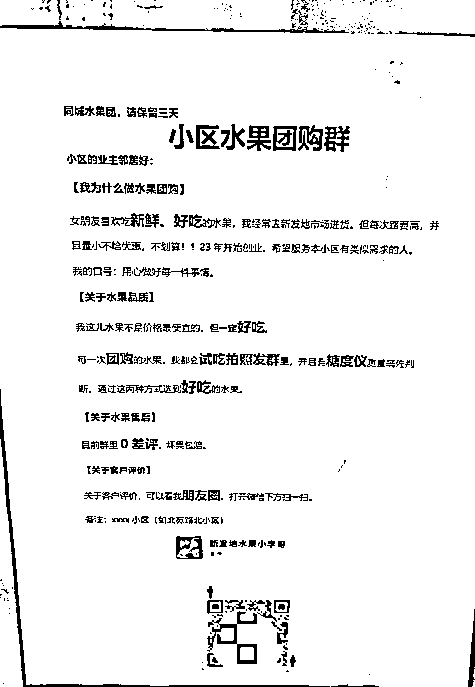

# 4.7 方法七：线下广告拉新，把邻居引进群 @李晓飞

在住宅小区做线下获客，通常有两条路可走。

第一条，直接拉起一个水果群。路径短、目标清楚、命中率高。

第二条，建“小区闲置群”。这是居民的高频需求，进群意愿强、转化也高。你是群主，后续可以用小号配合，把群成员逐步筛选、沉淀为购买群。闲置群本身还能延伸出不少变现方式，这里不展开，核心逻辑就是：用户有需求，就有生意可做。

对小区里的宝妈来说，这两种方式都挺合适。

另外，也可以找门店或快递点合作。在北京，这类合作费用大约每月 100 元。关键是把老板的利益和自己绑在一起：让对方成为自提点，再按单量给分成，拉人的效率会更高。找合作时，可以从多多驿站、美团自提点这类渠道切入——他们本来就在做自提，也想多赚钱，所以更容易谈。

还有一种偏另辟蹊径的做法，但能不能用，要结合所在城市和具体小区来判断。

如果你要获客的小区允许张贴广告，下面几个小技巧可以参考；如果小区不允许，是否要尝试需要你自己判断，也可以考虑贴在公示栏等位置：

1. 从高层乘电梯上去，自上而下一层层贴；低层就贴到单元楼门口，省得爬楼太累。最好选择有专门公示栏的地方。
2. 时间上，周五下午 4 点左右比较合适；周六日大家有空出来走动；夏天比冬天更有利，天气暖和，居民愿意出门，而且天黑得晚，广告留存时间也更长。
3. 用喷胶张贴，一喷一贴，效率很高。不要喷太多，稍微粘住即可；用胶带已经比较落伍了。
4. 广告文案可参考下方示例

内容出处：《新手做水果团购，首月交易额破 2 万，我是如何从 0 到 1 的？》

