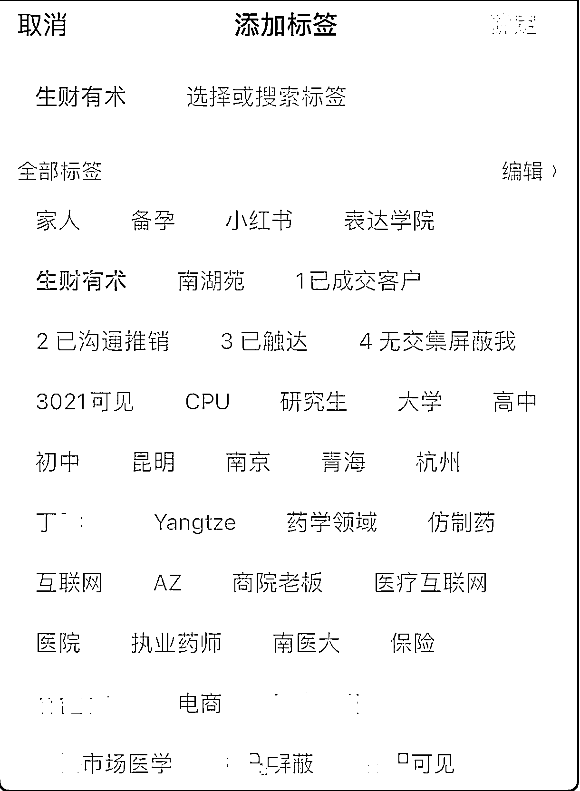
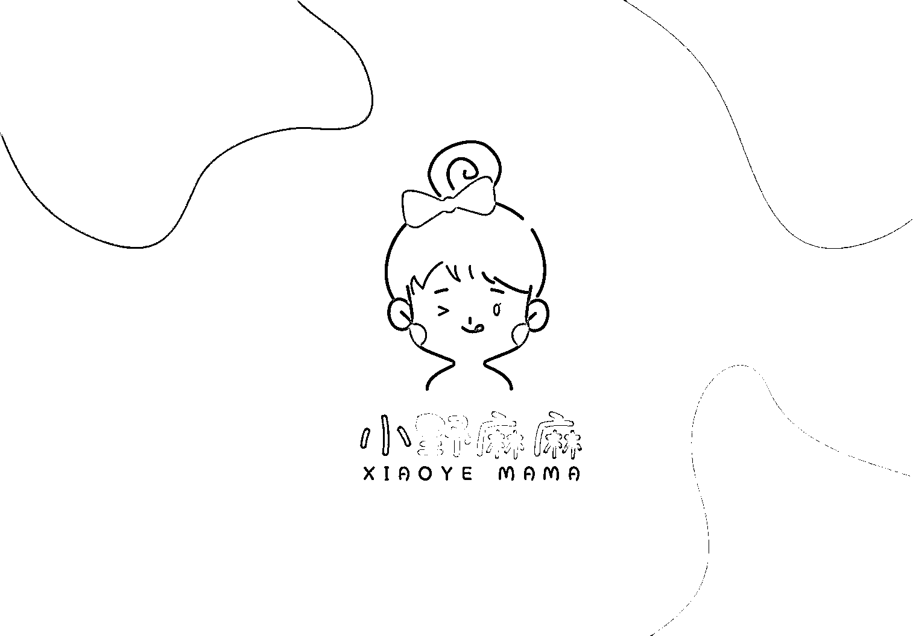
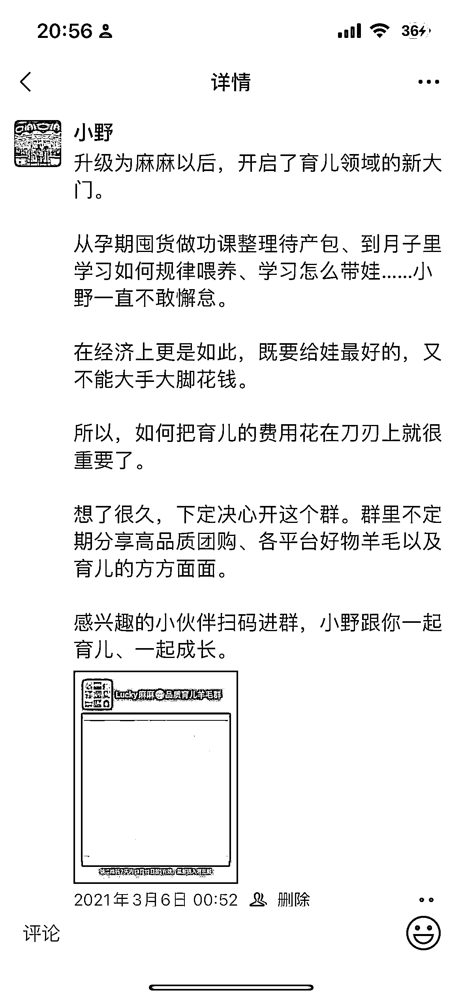
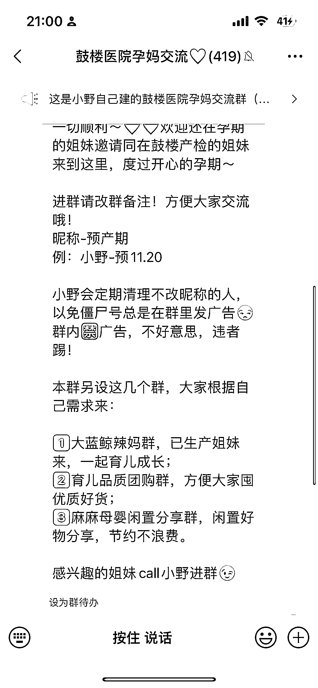

# 4.8.4 把信任变成团购群 @小野

**（1）先把转化前的铺垫做足**

在把从📕吸引来的姐妹真正带进团购群之前，我先做了三层准备：

第一，从引流环节开始，就给每位🛰️好友打上“📕/备孕”标签，方便之后朋友圈精准运营；

第二，正式转化前先把群搭好，群公告、群规等内容提前写好；后来连团购主页的品牌标识也补上了，整体显得更专业；

第三，入群介绍和邀请文案要花心思，别只甩一句简短通知加一张二维码。文案既要有明确态度，也要有人情味，还得能引起共鸣，让对方有理由愿意进来。

**（2）私聊邀请，同时给每个群留好转化入口**

之前已经积累了不错的信任，我就逐个发消息，告诉对方自己新开了团购群，感兴趣可以来逛逛，结果多数姐妹都愿意加入。同时，每个群都提前设计好能触达成员、带动转化的钩子。

另外，我手上还有几个孕期交流群，可以让群与群之间互相导流。这样几个社群联动起来，已有流量就不会浪费。

**（3）群裂变的关键：真心换口碑**

团购群刚建好时，多数人会先观望一阵，之后才决定下单。

可一旦她们体验过靠谱的团购服务，就会主动把其他育儿交流群里的朋友也拉进来。到后来，靠自发裂变带来的人数，甚至超过了前期硬广拉新。我的体会是：想让群持续裂变、发挥更大价值，真心和口碑才是最可靠的办法。

内容参考：《新手做水果团购，首月交易额破 2 万，我是如何从 0 到 1 的？》《作为职场宝妈，我如何从📕引流并做到百万营业额的？》
