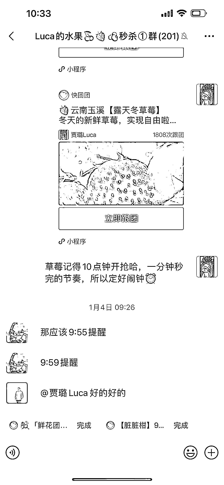
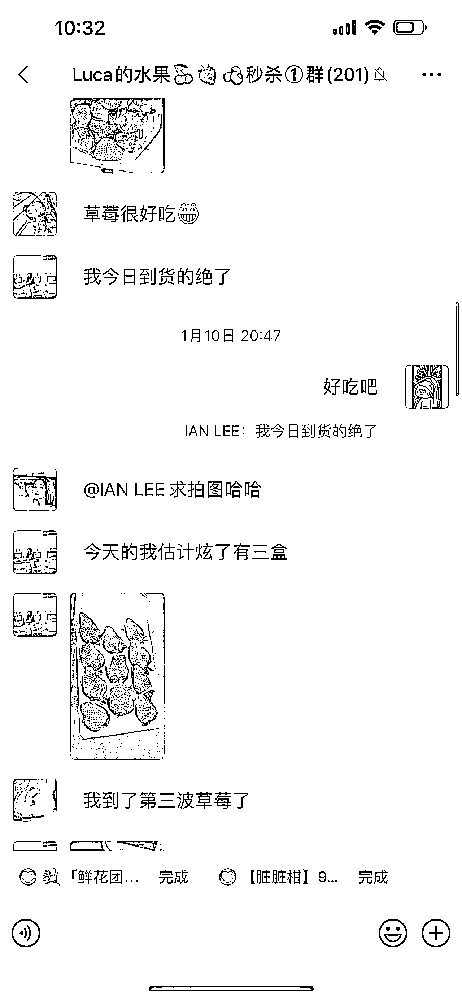

# 5.7 方法七：制造饥饿感+点燃从众心+现场比价 @贾璐 luca

第一步，饥饿营销。每天上午 10 点准时开抢，只放出 200 份，抢完就收。不少用户专门定了闹钟等着买草莓，生怕错过。

第二步，刺激购买。利用大家“跟着买准没错”的心理，让群里每天都有源源不断的好评和晒单，以此带动其他人下单。这里要特别提醒：好评里得有一小部分是“气氛组”在带节奏。没有托儿撑场面，群很快会变成一潭死水。

第三步，同类对比。选品时，首要条件就是性价比够硬、品质有保证。然后把知名超市和水果店对同款水果的标价、实物照片发到群里，形成直观反差，用户一看，顿时觉得捡了大便宜。

内容来源：《快团团新手如何帮卖月佣金达到 8 万》

