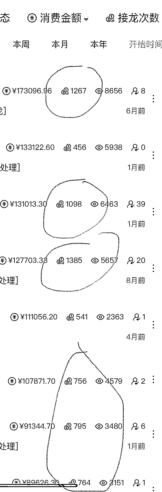

# 6.1 售后做扎实，复购自然来 @刘梁

社群团购是什么？就是在社群场景里，借人与人之间的连接，把各种商品卖出去。快团团、群接龙这类工具，本身就是伴随社群团购成长起来的：商品支持一件代发，选品团长和团品资源都很丰富，卖货团长与供货端可以双向挑选。对卖货团长来说，最基础也最关键的一件事，就是经营好人与人之间的关系。

那么，交易中哪个环节最容易跟顾客一对一聊、产生直接连接？答案通常是售后。卖货阶段，顾客会刷朋友圈、看群、点链接，商品信息写得清楚，她们自己就能快速了解。真正最主动、最需要团长出面的时候，是收货后发现不合适、货有问题、品质不达标或发错货，需要有人解决。此时团长的沟通态度、回应速度，以及售后有没有跟到闭环，会直接影响顾客的购物感受，也影响她是否复购、是否愿意拉朋友进群，进而影响社群裂变。你珍视顾客，顾客往往也会回报善意；当然，团长也不必卑微求人，我们有底气——我们是美好商品与事物的分享者、提供者，同时也有责任把售后做好。

我的社群最初只有一百多人，后来逐步增长到七百多人，很多成员都是靠口口相传、朋友带朋友进来的。虽然增长不算快，但多数是有效客户，复购率很高。社群团购拼的就是复购，最终目标是让同一个人愿意买一千次。我看过自己的客户数据，不少人都复购了几百甚至上千次。

具体怎么做？可以从四个方面落地：

1）反应快一点
平时有空多留意手机，看到售后诉求就尽快回应，并同步给选品团长，也就是大团长。需要退换货的，及时要退换货地址；生鲜出现品质问题，就和大团长沟通退款；如果大团长没有迅速处理，后续还要继续跟进，让每笔售后都形成闭环。

2）态度软一点
和顾客沟通时，先认可对方感受，站在同理心上解决问题。消费者没有对错，把问题解决才是关键。就算争论赢了又如何？她一气之下不再下单，损失还是团长自己。要时刻记得：这位顾客是要在我们这里买一千次的人。

3）让利大方一点
做团购有利润，就要舍得把售后福利给到团友。比如我们社群的福利是：退换货产生的运费全部报销。如果团友不满意，大团长又不给退换或售后，那我就自己承接，把费用退给团友，大不了自己留着用或送朋友。要让团友知道，每一次购物都有团长兜底。只要购物体验舒服，未来她还会持续复购，也会不断介绍朋友进群。

4）心胸宽一点
团长的心胸要宽广，得像山川一样，才配得上“团长肚里能撑船”。举个例子：有位团友跟我买了37码的鞋，说太小要退，我安排退货并报销运费；她重新拍了38码，又说太大还是要退，我依然二话不说给她退，运费照样报销。当客户在别处得不到这种包容服务，她就可能变成铁粉，持续复购一千次以上。

内容参考：《讲讲社群团购里的重中之重——售后服务》

