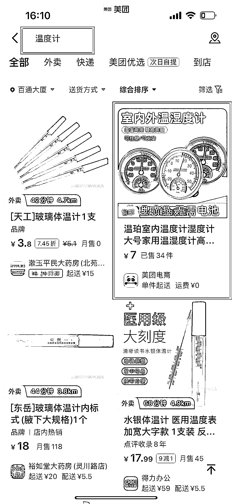
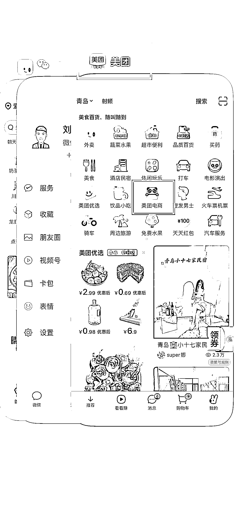
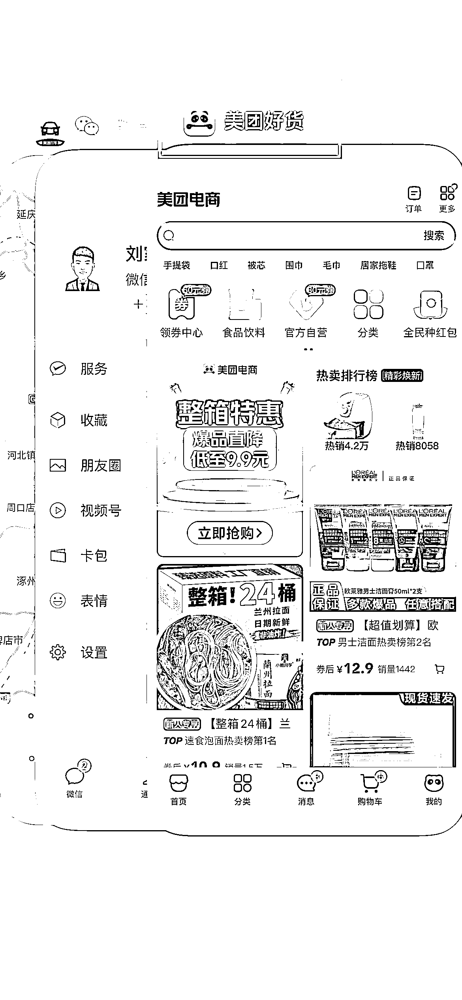
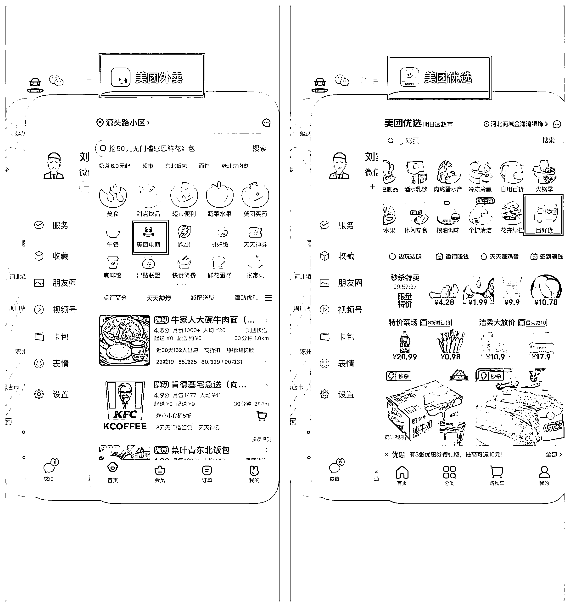
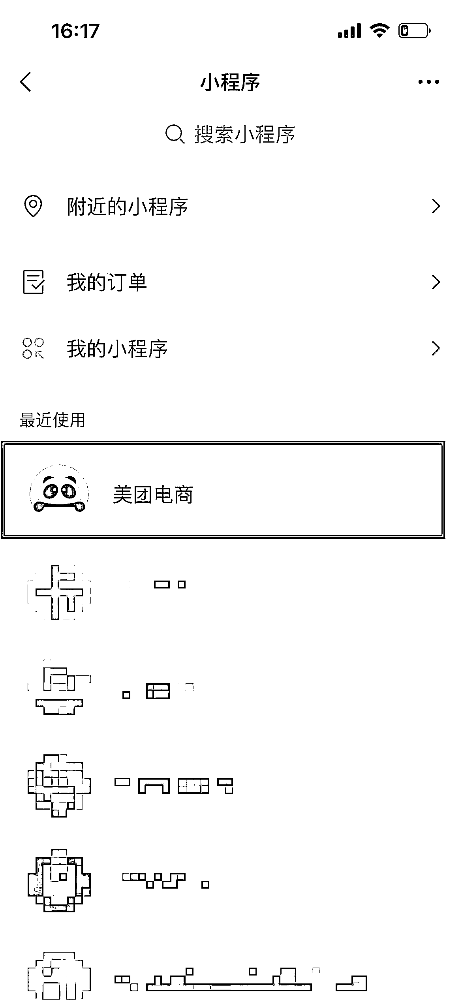

# 1.2.2 流量从哪来

跟淘宝、京东、拼多多这类成熟电商平台相比，美团电商的流量池确实不算大。但别忘了，两边商家数量的差距是数量级的；再加上美团要把本地服务近十亿用户逐步电商化，这条路虽然长，分摊到单店头上的流量依然值得期待。

眼下美团电商的流量，大头是补其他业务板块 SPU 缺口时溢出的搜索流量——比如美团优选某些商品 SPU 不全，用户搜索需求就会外溢到这里；猜你喜欢之类的推荐流量则起辅助作用。

具体来看，流量入口大致分布在以下几处：

美团主站搜索入口：

美团首页金刚区导流：

美团电商独立 App「美团好货」：

其他独立 App 的二级、三级页面（如美团外卖、美团优选等）：

美团电商🛰️小程序：

