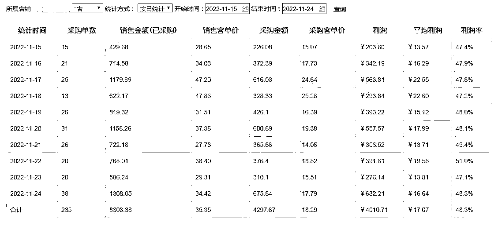
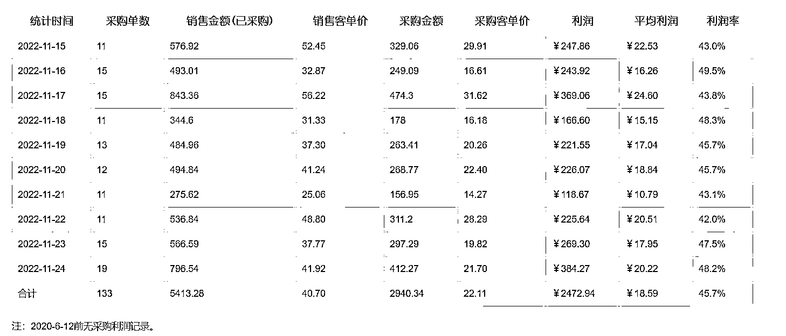
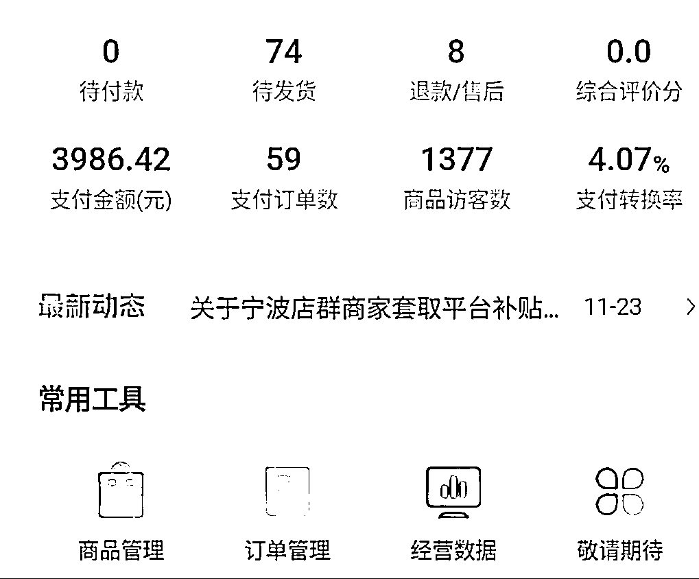

# 1.3 两种无货源打法，怎么选？

电商平台上的赛道和玩法很多，无货源卖家到底该走哪条路，并没有统一答案。结合多数人的实际情况，再参照店铺数量和资金量级，可以把方向归为两类。两者底层思路完全不同：一类靠足够大的数量去摊平概率，另一类靠单点做深做透、把爆款打出来。先看清自身条件，再从下面两种模式里挑更适合自己的。

**打法一：多店、资金较足、轻运营——单店月利润约3-6K**

这套模式的核心，是用数量优势去对冲不确定性。店铺铺得够多、资金相对充裕，运营上不必抠得太细，整体走“粗放”路线。它更接近财务算账：不盯某一家店能产出多少，而是把投产比算明白，投入多少、回报多少，能不能过自己的财务账。

门槛在于手里要有一定资金体量；如果是有两三个人以上的小工作室，会更适合。

**打法二：少店、资金有限、重运营——单店月利润约6-15K**

电商做到最后，绕不开精细化。不管是直播带货，还是传统电商，精细化都是商家竞争加剧后的必然结果。

在资金和店铺数量都有限的前提下，把运营做细，让单店产出尽量拉高。这类模式更适合预算不宽裕的团队，也适合一个人单干。

