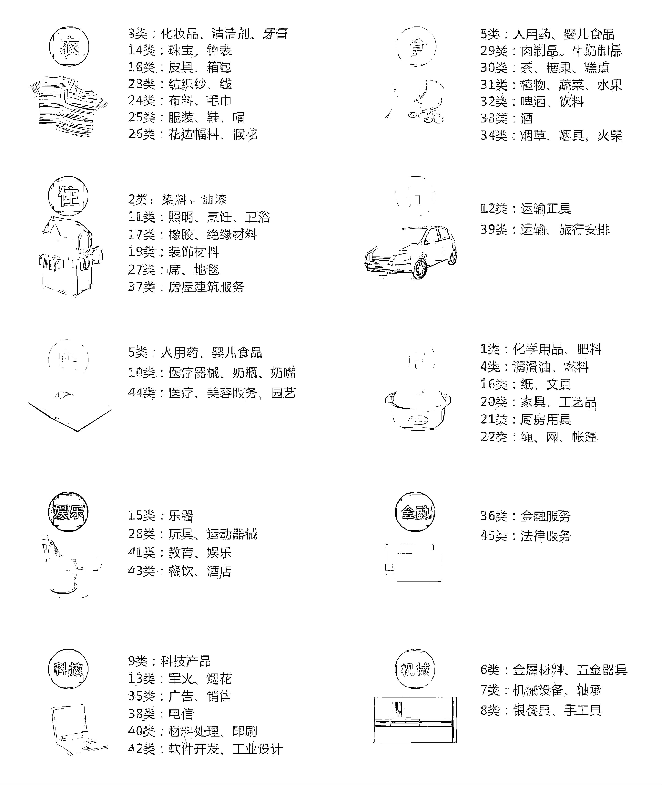

# 第二步：商标怎么选？

先搞明白一件事：品牌做授权，通常只覆盖美团的二级类目。你要做的，是拿着下方图片里的商标分类，先锁定想入驻的二级类目，再去找持有对应品牌的三方渠道开通授权。

不过要留个心眼——美团店铺的二级类目和商标分类的命名并不完全对得上。比如美团这边叫“体育用品”，商标图谱里却叫“运动器械”。东西是同一个东西，纯粹是叫法不同。

选商标时，挑那种定义清晰、没有模糊地带的。拿“体育用品/鞋服”这个类目来举例：

- 尽量选第28类“运动器械”的授权，而不是第25类“鞋服”商标。为什么？因为体育用品比服装的商标指向性更强，之后上架健身器材这类商品，平台审核时不容易产生误判，也不会有争议。
- 再看哑铃和运动服这两样商品，如果店铺只拿着鞋服类商标授权，上架时就得特别小心——服装类商标覆盖不了体育器械的审核要求。

