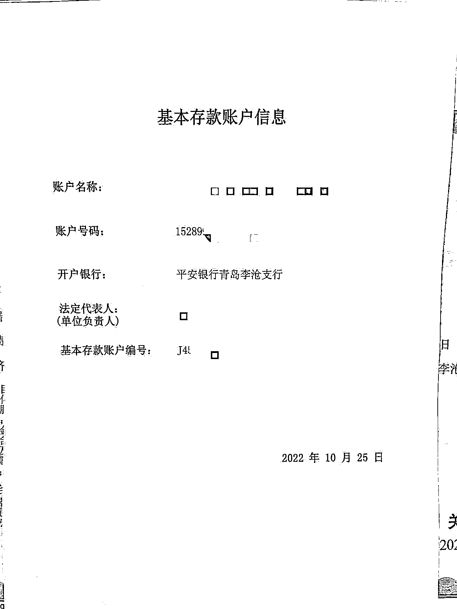
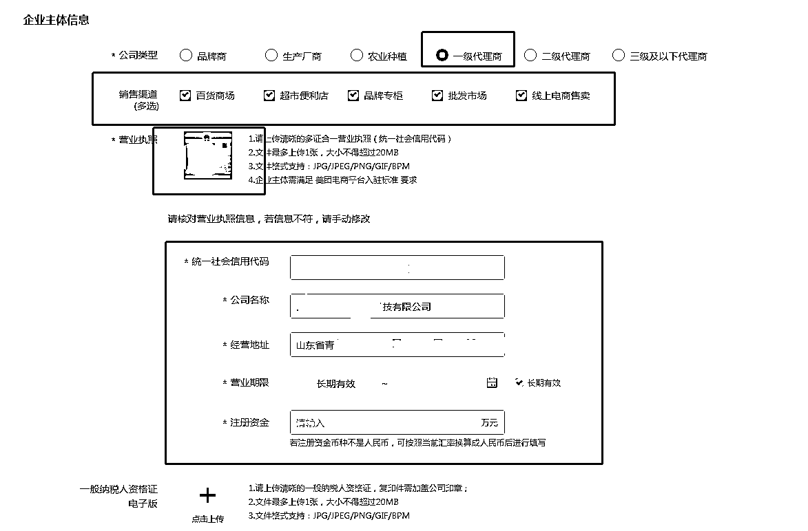
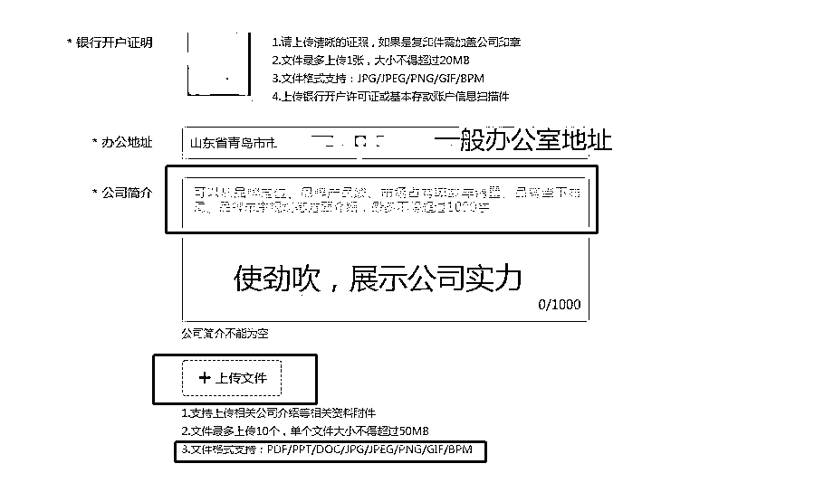

# 2.3.3 公司主体资料填写要点

店铺类型选好后，接下来就要提交公司主体相关信息。这一步看着不复杂，但几个细节没填对，很容易被退回。

1. 公司类型要和商标授权级别对应起来。通常来说，小品牌商标对应的是一级代理。
2. 销售渠道建议全部勾选。
3. 银行开户证明示例：

4. 公司简介附件处可以放企业宣传册、PPT 之类的材料，格式没有硬性限制，重点是把公司实力展示出来。模板可以按自己的情况到百度文库等平台下载，再结合公司实际修改使用。

参考写法：

青岛 XX 网络科技有限公司注册资本 100 万元，团队 40 多人，位于山东青岛，主要从事运动健身器材业务。产品可服务于家庭个人健身、户外休闲运动、公司团建器材等多种场景，能够满足不同使用需求。公司把优秀团队、先进技术、精良设备和严格管理视为持续发展、赢得用户信任的基础，秉持“精确、可靠、专业”的生产与服务理念。公司不断引入国内外先进技术与工艺，并结合多年运动行业经验，使产品在精度、稳定性和可靠性方面处于全国领先水平。线上京东、淘宝等平台既有自营店，也有合作商；产品已完成从第一代到第六代的迭代，目前仍在研发更高端型号。依托技术、品质和服务优势，公司产品进入运动用品行业前列，并销往全国各地。经营上坚持市场导向、科研带动、创新驱动，积极拓展市场。

提醒：不要直接套模板。提交内容如果和大家都一样，审核很容易不通过，务必自己动手去百度等平台找资料，并改成适合自己公司的版本。