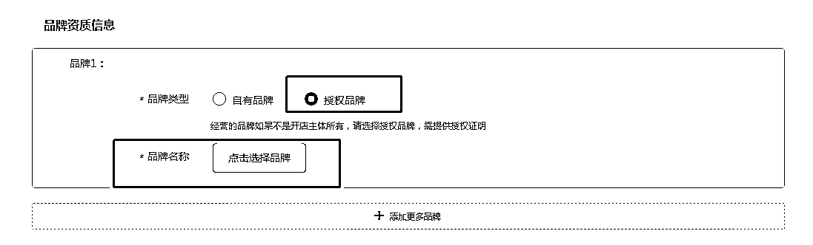
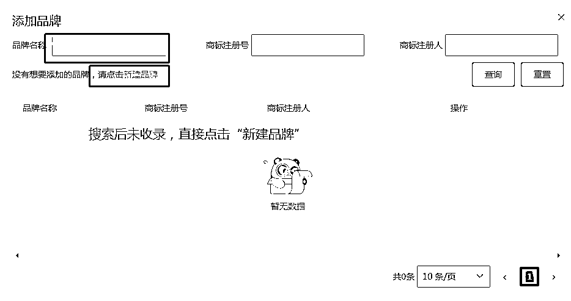
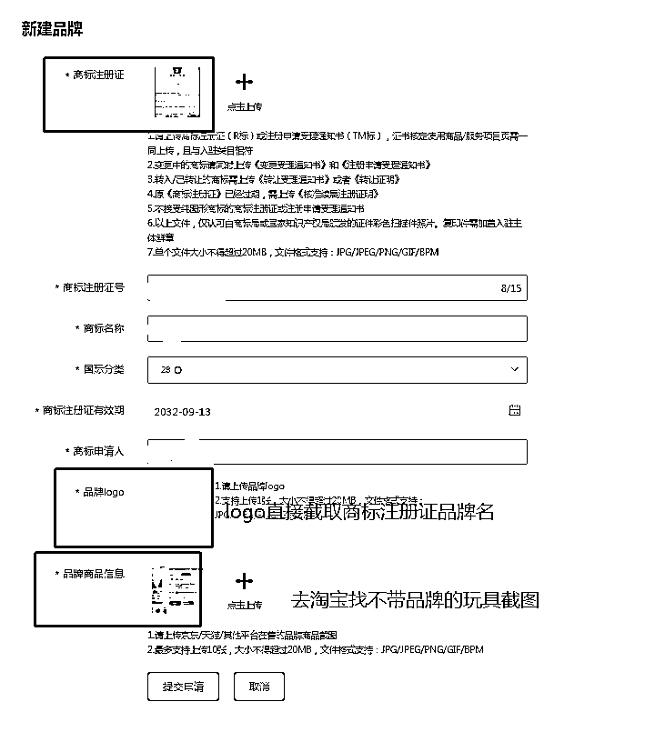
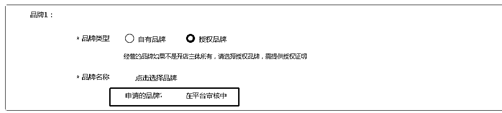
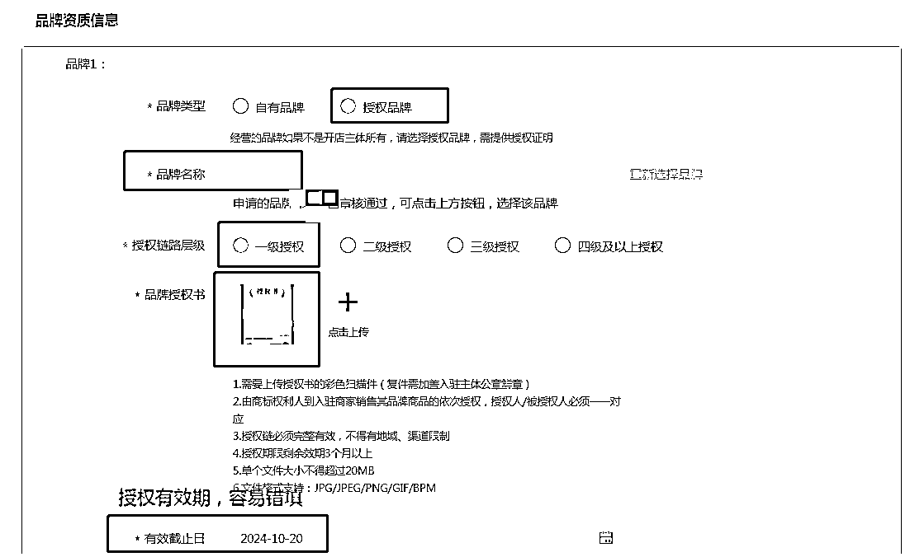
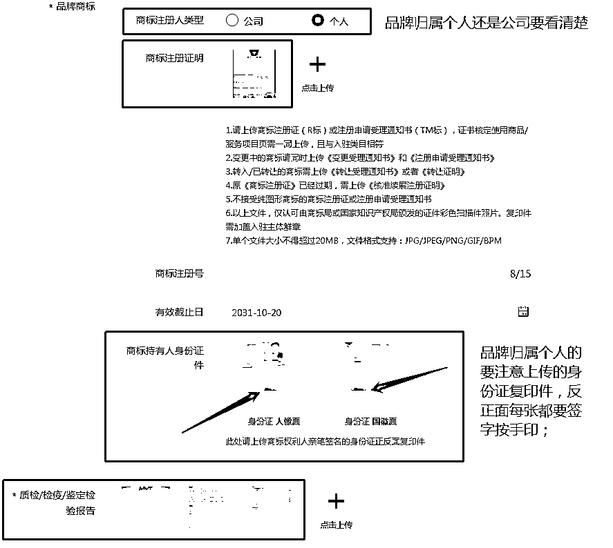

# 2.3.6 资质信息填写指南

填写资质信息时，按顺序操作会更顺畅。

第一步，先找到要授权的品牌，点击品牌选择入口。

第二步，确认该品牌在美团品牌库里有没有记录。查不到的话，需要自己新建录入，并等待品牌收录审核通过，之后才能提交入驻申请。这个审核通常要2个工作日左右。

第三步，如果品牌已经收录，直接搜索并选择就行：

• 品牌录入提醒：
• 搜不到对应品牌时，点“新建品牌”；
• 商标注册证要上传；品牌Logo不用另做，截取商标注册证里的品牌“文字”部分即可；
• 品牌资料要和主营商品对应，可以去淘宝找没有品牌标识的截图来用；

• 审核环节提醒：
• 商标收录资料填完后，若页面提示“申请的品牌“XXX”在平台审核中”，说明要等审核；通过后再接着填，这时先保存并退出；
• 收录申请审核通过后，页面会继续提示补充信息；
• 如果品牌持有人是个人，复印件必须签字，正反面每张都要签字并按手印；
• 质检报告照着页面图示传上去就行；

