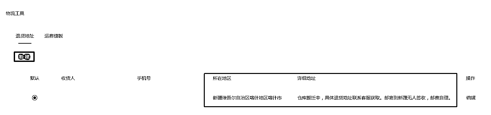

# 2.4.1 退货地址这样设

做无货源模式的朋友要留意：每款商品的发货仓和退货仓无法提前确定，因此后台的退货地址暂时统一填写新疆地址。填写时，要在地址备注里提醒买家：准确退货地址需联系客服获取；联系电话则要留一个消费者能打通的号码。

例如，地址可先填“新疆维吾尔自治区喀什地区喀什市”，备注写明“仓库搬迁中，准确退货地址请找客服获取”。同时要提醒买家：寄到新疆的包裹无人签收，相关运费由寄件方自行承担。

