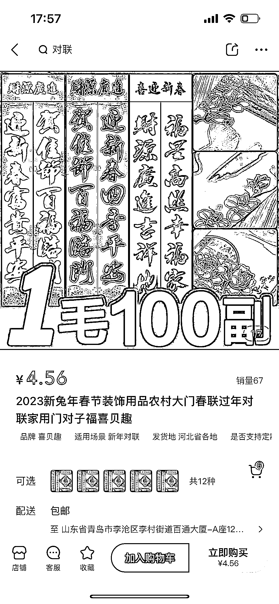
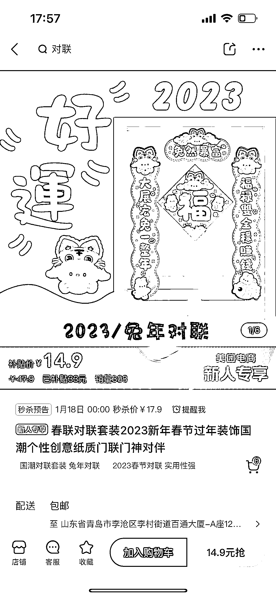

# 3.2 选品，先过颜值关

美团平台上的消费者以年轻人为主，因此挑货时，实用当然不能丢，但在此基础上，外观表现会被放到更重要的位置。具体来说，主要看两方面：

1）产品本身要好看：年轻人对美的追求直接而坦率，好看就是硬道理；

2）展示图片要好看：主图清爽精致，尽量少加水印和杂字，整体拍出高级感。

下面用两张图片做对比说明（图一为反面示例，图二为正面示例）：

反面示例

正面示例

