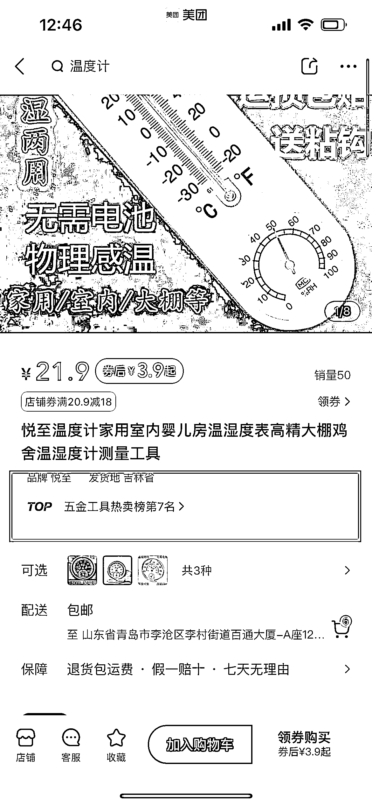
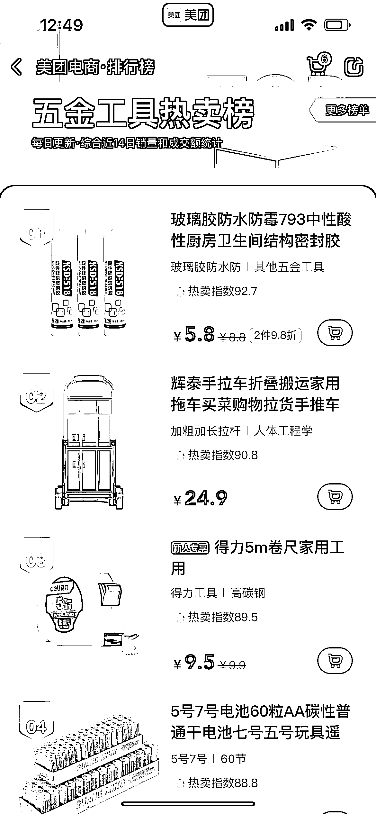

# 3.3 选品实战指南

选品没有标准答案，但以下三种思路可以帮你少走弯路：前两种推荐使用，第三种不推荐。

【推荐】方法一：淘宝爆款筛选法

这套打法的本质，是借力已经被市场验证过的商品。能在淘宝这种红海平台里真正跑出来的产品，品质、物流、服务等方面都扛过了真实订单的考验。而且搜索结果靠前的商品，审美上更贴近大众，价格也相对合理，属于安全牌，不容易踩坑。不过价格带一定要控制好。

具体做法：在电脑上打开淘宝网站，结合美团店铺对应的四级类目去寻找目标商品。四级类目能帮你锁定更精准的爆款。筛选时，重点看五个指标：

- 月销量≥2000笔，最低也别低于1000笔。这个门槛能过滤掉店群同行，通常店群很难冲上1000笔的量。
- 主图不能出现品牌和价格。一旦涉及品牌授权，商品就无法上架，而且每天上架都要过人工审核。
- 店铺DSR评分要达到4.8分及以上，物流单项分也不能低于4.8分。这样上家的品质、物流和服务才有保障。
- 最低SKU价格保持在10元到200元之间。因为上架时要按两倍价售卖，超过200元很难卖出去，低于10元翻倍也没有利润；同时蓝海平台靠高利润吃饭，低价单太多还会招来死拍单号。
- 商品必须包邮，而且不能限制购买数量。这样既方便处理售后，也能防止客户退货时我们损失发货运费。

方法二：榜单跟款法

这个策略是跟着美团电商已经验证过的榜单爆款走。比如某款收纳架进入了美团畅销榜，你马上到淘宝搜同款，或者找一款价格更有优势的类似品上架，完成跟款。

操作步骤：

1）在目标选品类目里，先找到任意一个已进入美团“热卖榜单”的商品：
2）点击进入热卖榜单，看看哪些商品在热销：
3）根据榜单爆款，再套用方法一的上家筛选标准，选择直接跟款，或者选榜单上的相似款式。更建议选择类似款，因为1:1跟款在价格上几乎占不到便宜。

【不推荐】方法三：抖音/其他平台爆款选品法

这种方法是依据抖音等其他平台的爆款商品视频来选择跟进对象。大多数抖音爆款都是靠信息流或落地页形式的广告推荐，通过平台算法匹配到最精准的流量，然后直接在落地页里成交。但在消费者眼里，二类电商的信任度不如一类电商。不过这类商品通常有流量溢出，溢出的流量流到其他平台后，反而有可能带来意外销量。

操作步骤：

1）用飞瓜、蝉妈妈、考古+等第三方短视频数据平台，查询爆款商品排行榜；
2）对照排行榜来完成跟款选品；
3）找到目标产品后，去淘宝网、1688等电商平台找价格更低的上家，直接上架。
4）不过这种方式在蓝海平台早期并不适用，核心问题就是效率太低。
5）想要掌握更细的操作，可以回看往期《抖音短视频手册-选品方法》。

最后再强调一下：选品方法终归只是辅助，也是日常管理员工的一个抓手。无货源模式效率优先于质量，测品比选品更重要，要用足够的基数去测，让优质商品靠数据自己冒出来。蓝海平台野蛮生长阶段，上新效率始终是核心。

