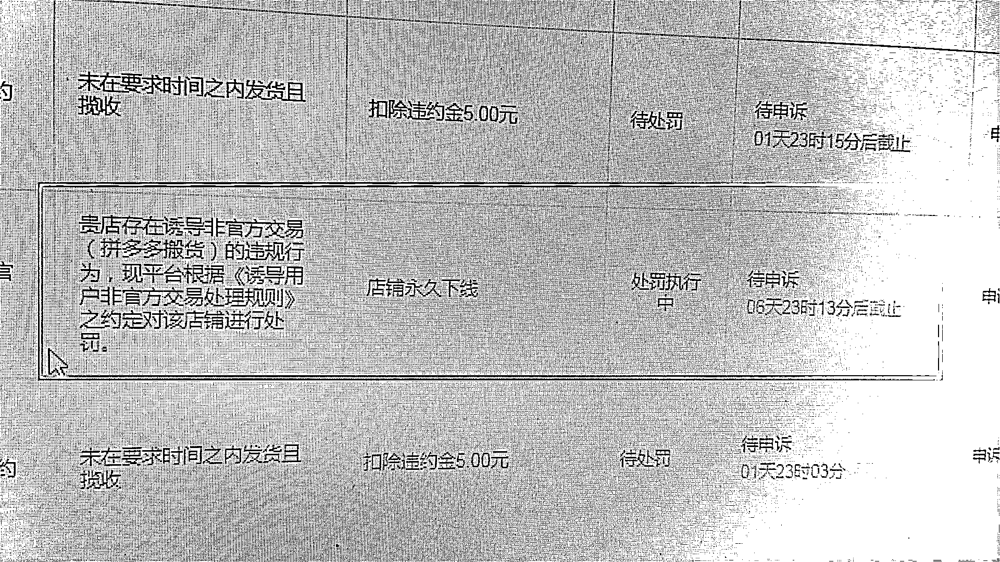

# 3.4 选品别踩坑

先说结论：美团电商还在平台发展的早中期，选品不必像成熟电商那样抠到极细；窗口期里，出手快往往比追求完美更重要。

同时，新平台的规则调整比较频繁，违规违禁品千万别碰，处罚力度不轻，硬跟平台规则对着干只会吃亏。

基于这两点，选品时重点注意下面两类情况：

1）平台红线

拼多多商品不要直接搬，不要搬，重复三次：不要搬。否则结果就是：

2）违规与不推荐产品

下面这些产品，要么违规风险高，要么售前售后难度大，不建议选择：

• 退换货率高、售前售后链路复杂的产品（比如女装、需要指导安装的精密仪器等）

• 预售类

• 国际名牌

• 军警、国家政府相关擦边产品

• 博彩类

• 宗教迷信类

• 需要特殊资质的产品（工业生产许可证、产品经营许可证）

• 卡通人物相关（奥科曼、黑猫警长、变形金刚等）

• 钱币及周边产品

• 开锁工具

• 化学原料等

• 虚拟类目

• 其他违法产品

