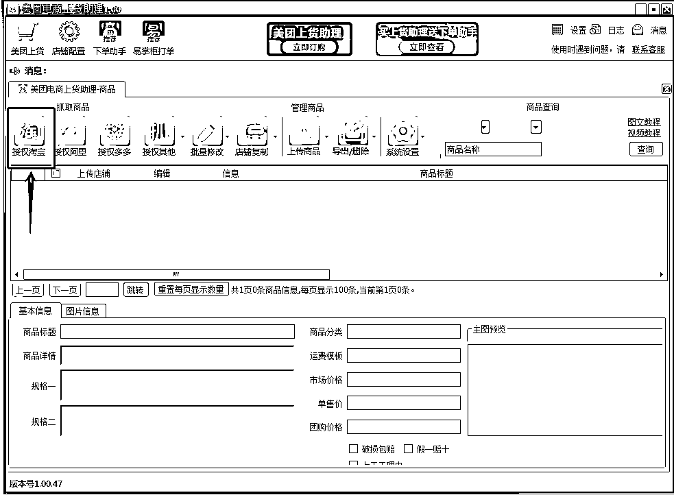
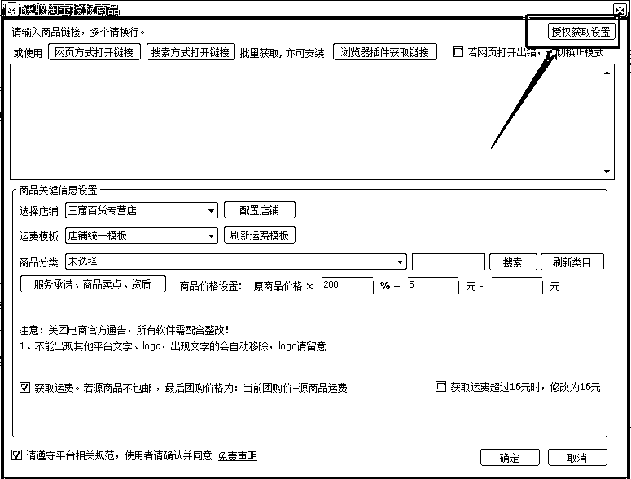
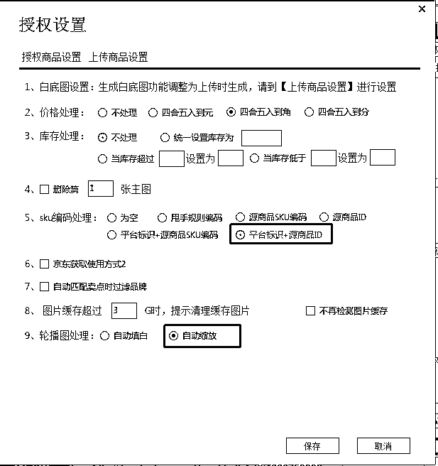
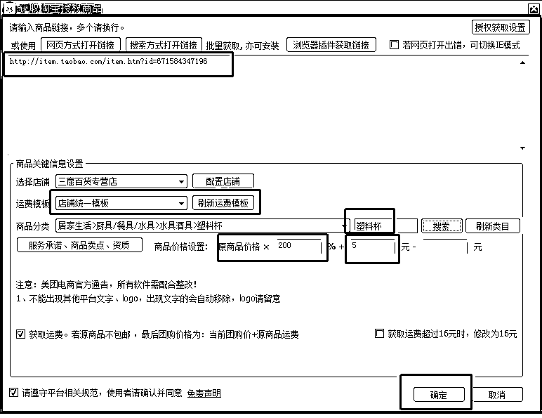
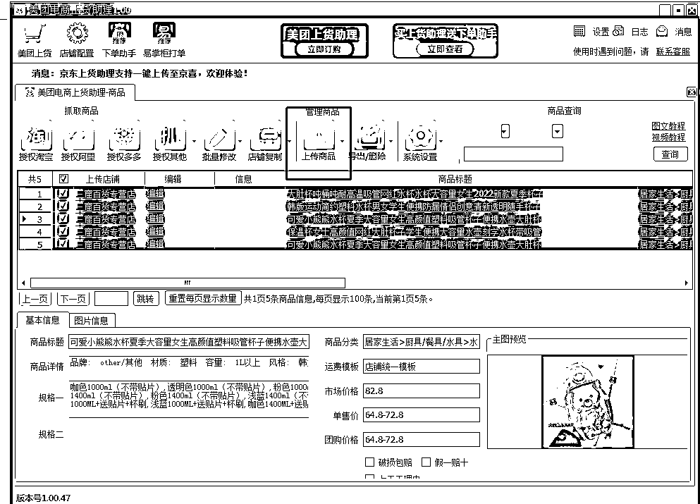

# 4.2.3 商品上架五步法

想把商品顺利搬到店铺？按下面五步操作即可。以淘宝货源为例：

第一步，进入对应平台后先完成淘宝授权，点一下“授权淘宝”按钮。

第二步，找到并打开“授权获取设置”。

第三步（关键）：保存前务必勾选“平台标示+源商品 ID”和“自动缩放”，其余选项保持默认再保存。漏掉这一步，由于没有用甩手拍单采购，后续很可能出现无法拍单的问题。

第四步，上传前按图示红框完成设置：

1）把淘宝上家的商品链接复制进软件；
2）运费模板选此前新店设好的统一模板，点刷新就能看到；
3）依据商品所属类目，选美团店铺对应的三、四级类目，切勿错放类目，否则可能面临违规处罚；
4）上传价按“两倍加5元”设置。

第五步，进入“上传设置—上传商品至草稿箱”，提交后即完成上架。

